# Telemetry ↔ PassMark Score Correlation Report

Generated from `C:\Users\Local_Admin\Desktop\passmark-socwatch-emon-win\Results` — 4 runs with usable data (PassMark + SoCWatch, EMON).

## Test-Bed Configuration

- **CPU**: Intel(R) Core(TM) 5 223PE

- **Cores/Threads**: 8 cores / 16 threads

- **Memory**: 64 GB across 2 module(s)

- **BIOS**: RPLISFI1.R00.7116.A53.2605211546

- **GPU**: Intel(R) UHD Graphics 770 - driver 32.0.101.7085 (03/02/2026 16:00:00)

- **Power plan**: varies per run (4 plans tested: Balanced, HighPerformance, Powersaver, UltimatePerformance) — see breakdown below.

## Methodology

- **PassMark** supplies one composite/sub-test score per run (`PassMark_PerfRes.txt`), not a time series.
- **SoCWatch** (`socwatch.csv`) supplies whole-run summary telemetry: average package power (mW), average active CPU frequency excluding idle time (MHz), and package C-state residency (% time in ACPI C0 = active).
- **EMON** (`emon.csv`), where present, supplies ~1-sample/sec counters across the full run; these were averaged into run-level IPC and last-level-cache-miss-rate metrics.
- Each **run becomes one observation**; correlation (Pearson r) is computed **across runs** between score metrics and telemetry metrics — this is the only valid level for score correlation since PassMark itself has no internal time resolution.
- ⚠️ **Caveat**: with **n=4** runs on a single SKU/system (one run per power plan), these are exploratory correlations, not statistically robust conclusions:
  - Each PassMark score is itself already an average across the run's internal **3 iterations**, so the *score* values have reasonably low pure benchmark-noise.
  - However, **telemetry (SoCWatch/EMON) was captured once per run**, not separately per iteration — so we don't know iteration-to-iteration telemetry variance (e.g., thermal ramp across the 3 iterations), and runs were executed back-to-back without controlling for thermal/background-state carryover between power-plan switches.
  - With only n=4 distinct conditions, a single atypical plan can dominate the fit — p<0.05 here should be read as a credible **directional** signal worth acting on, not a finalized regression. Confirming with 1-2 repeat runs per plan (especially for any plan that looks like an outlier) would turn this from directional into robust.

## Per-Run Summary Table

|             run | power_plan          |   PassMark Rating (Composite average) |   CPU Mark (Composite average) |   Memory Mark (Composite average) |   Disk Mark (Composite average) |   2D Graphics Mark (Composite average) |   3D Graphics Mark (Composite average) |   avg_pkg_power_mW |   avg_active_freq_mhz |   pkg_c0_pct |   avg_ipc |   avg_cache_miss_per_kinst |   collection_duration_sec |
|----------------:|:--------------------|--------------------------------------:|-------------------------------:|----------------------------------:|--------------------------------:|---------------------------------------:|---------------------------------------:|-------------------:|----------------------:|-------------:|----------:|---------------------------:|--------------------------:|
| 20261012_222828 | HighPerformance     |                                4635.3 |                        32074.5 |                            3746.1 |                         17297   |                                  507.5 |                                 2046.1 |            43133.3 |               4815.19 |        68.4  |      1.15 |                      22.62 |                    900.57 |
| 20261013_002440 | UltimatePerformance |                                5301.1 |                        32324.1 |                            3722.7 |                         17271   |                                  639.9 |                                 2129.1 |            38102.4 |               4826.31 |        60.79 |      0.87 |                      23.55 |                   1194.17 |
| 20261013_020821 | Balanced            |                                4273   |                        32263.5 |                            3565   |                         17389.9 |                                  447.7 |                                 2028.3 |            39347.6 |               4494.38 |        75.08 |      1.24 |                      14.7  |                   1195.98 |
| 20261013_033450 | Powersaver          |                                2280   |                        23889   |                            2684.2 |                         16546   |                                  234.2 |                                  798.9 |            18712.3 |               2884.12 |        79.39 |      0.83 |                      12.89 |                   1294.51 |

## Per-Run Detailed Plots (Side-by-Side by Plot Type)

Each completed run also has its own 4-plot deep-dive (generated by `analyze_run.py` / `analyze_all.py`), covering within-run telemetry trends that the cross-run tables above don't show. Grouped here by plot type so runs/power plans can be compared side by side; click/open an image for full resolution.

### Timeseries overview (freq / IPC / cache-miss)

<table><tr>

<td align="center"><b>20261012_222828 HighPerformance</b> 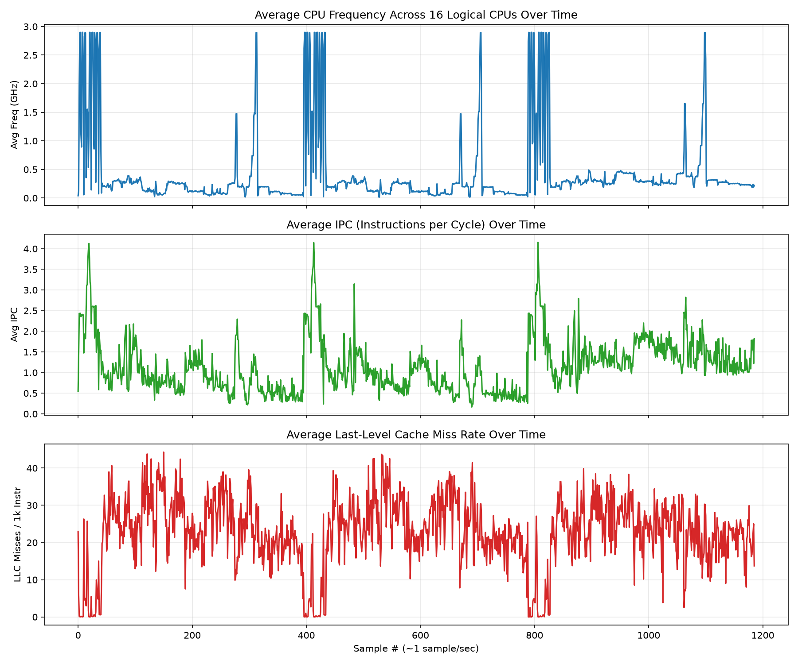</td>

<td align="center"><b>20261013_002440 UltimatePerformance</b> 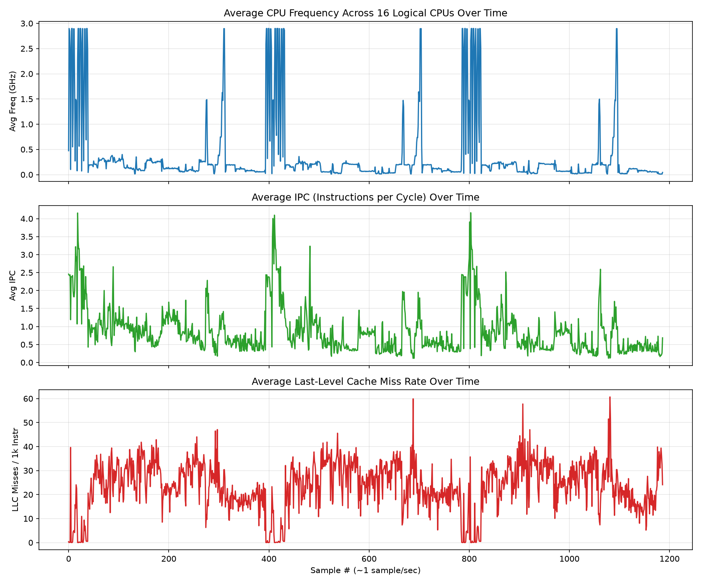</td>

<td align="center"><b>20261013_020821 Balanced</b> 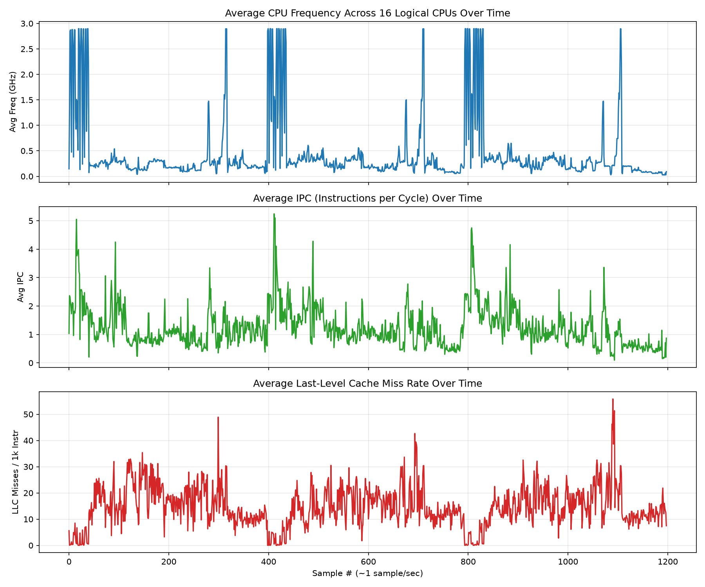</td>

<td align="center"><b>20261013_033450 Powersaver</b> 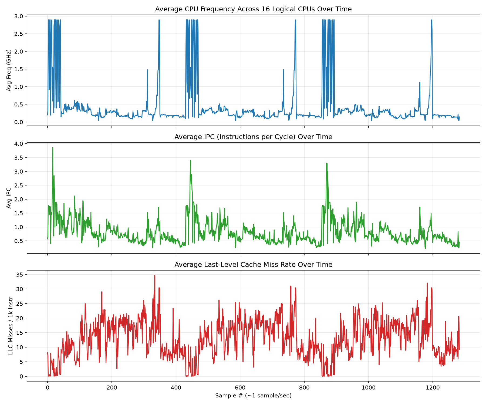</td>

</tr></table>

### Per-core frequency heatmap

<table><tr>

<td align="center"><b>20261012_222828 HighPerformance</b> 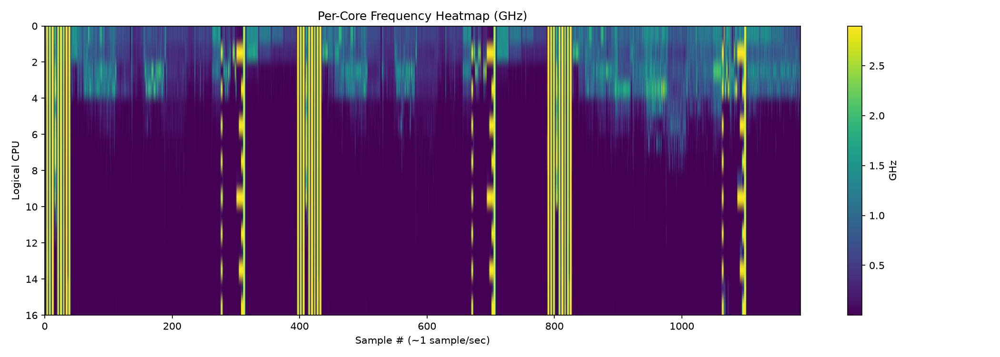</td>

<td align="center"><b>20261013_002440 UltimatePerformance</b> 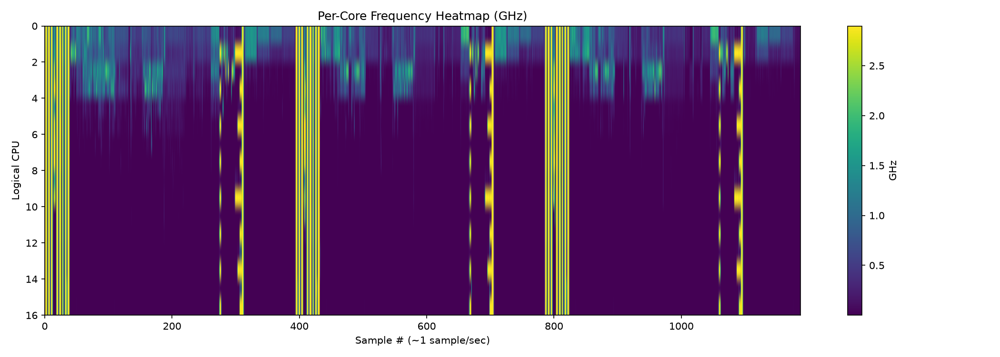</td>

<td align="center"><b>20261013_020821 Balanced</b> 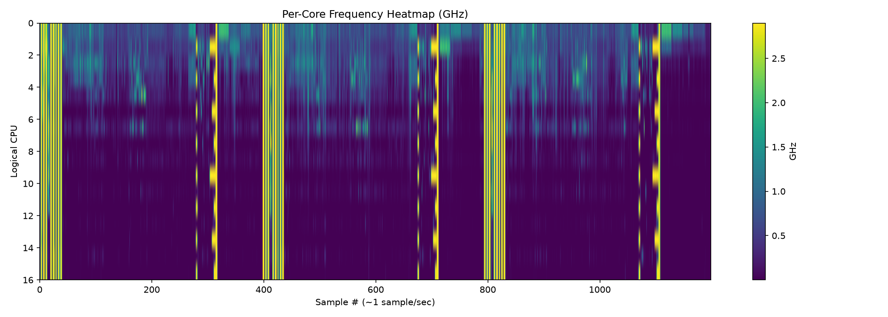</td>

<td align="center"><b>20261013_033450 Powersaver</b> 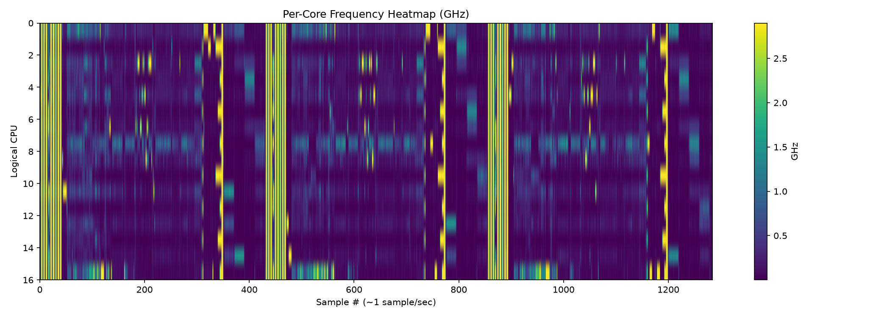</td>

</tr></table>

### C-state residency

<table><tr>

<td align="center"><b>20261012_222828 HighPerformance</b> 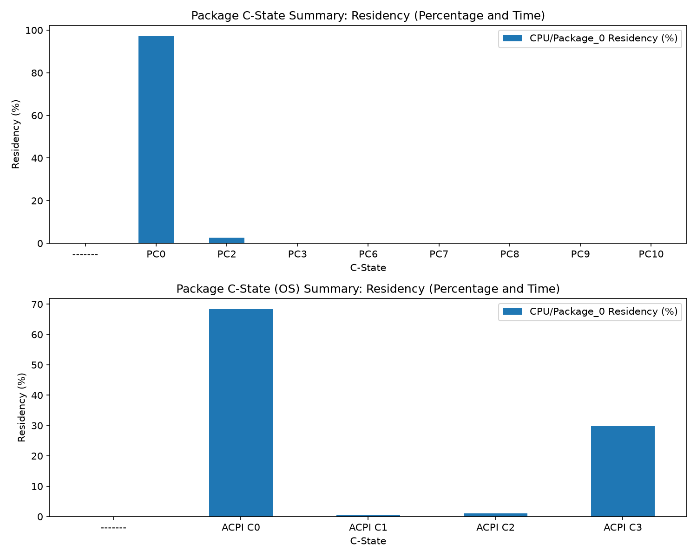</td>

<td align="center"><b>20261013_002440 UltimatePerformance</b> 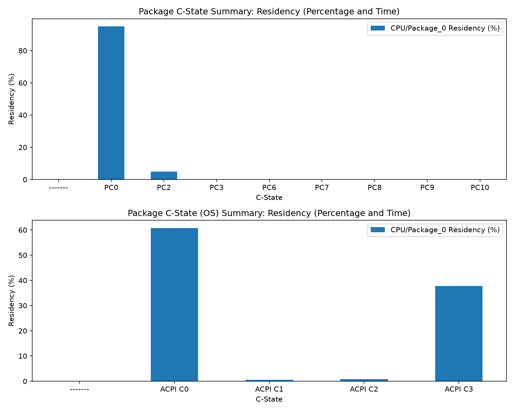</td>

<td align="center"><b>20261013_020821 Balanced</b> </td>

<td align="center"><b>20261013_033450 Powersaver</b> 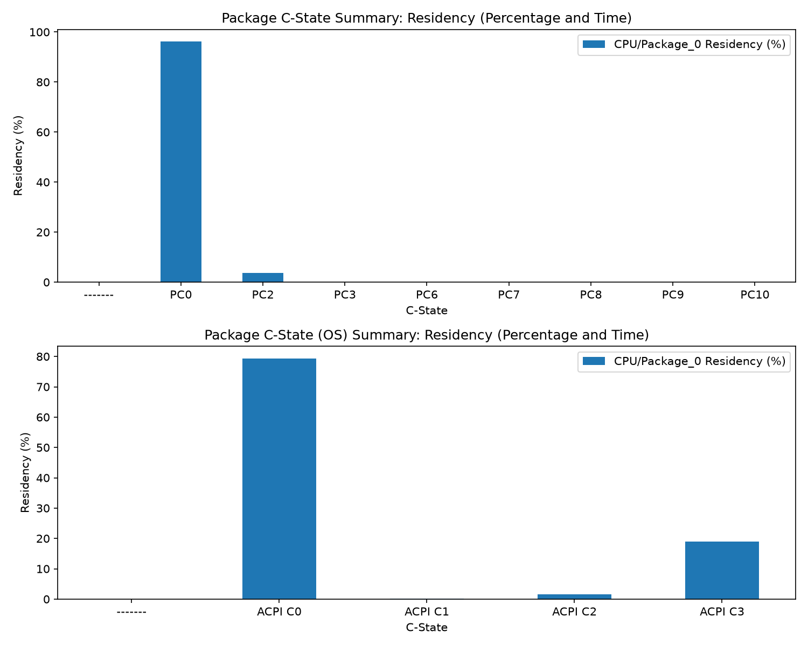</td>

</tr></table>

### PassMark sub-test percentiles

<table><tr>

<td align="center"><b>20261012_222828 HighPerformance</b> 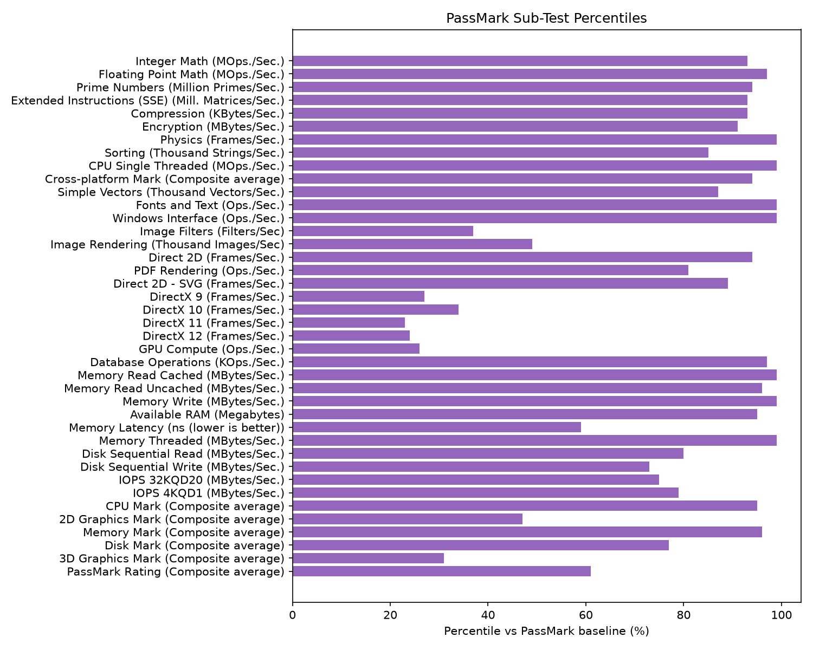</td>

<td align="center"><b>20261013_002440 UltimatePerformance</b> 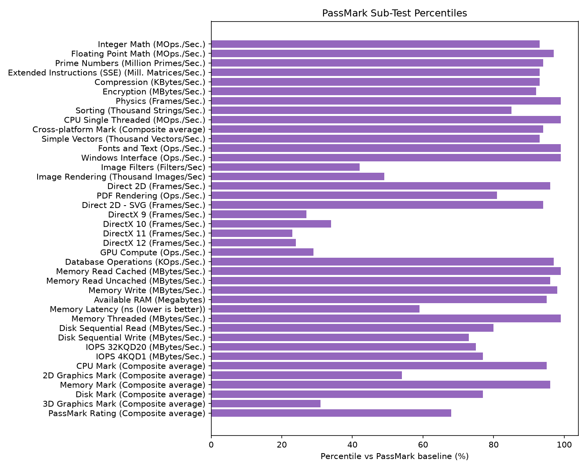</td>

<td align="center"><b>20261013_020821 Balanced</b> 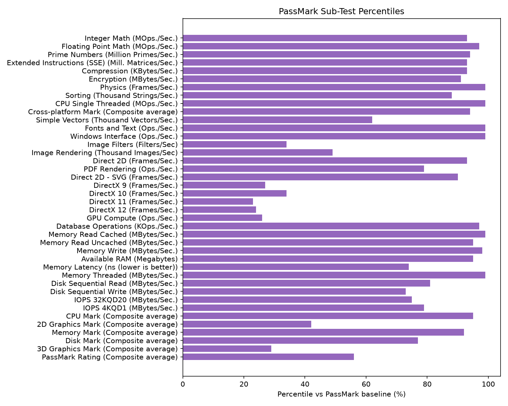</td>

<td align="center"><b>20261013_033450 Powersaver</b> 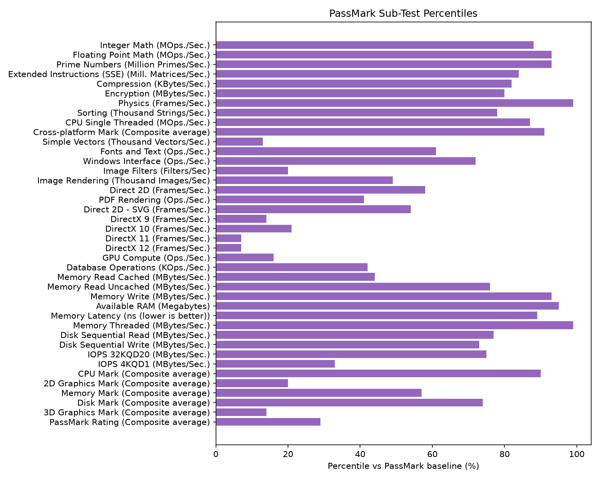</td>

</tr></table>

## Comparison by Power Plan

Grouped mean per power plan (n = number of runs in that group). With few runs per group this is **descriptive, not statistically significant** — treat as a starting point for which plan looks favorable per metric, then confirm with repeats.

| power_plan          |   n |   PassMark Rating (Composite average) |   CPU Mark (Composite average) |   Memory Mark (Composite average) |   Disk Mark (Composite average) |   2D Graphics Mark (Composite average) |   3D Graphics Mark (Composite average) |   avg_pkg_power_mW |   avg_active_freq_mhz |   pkg_c0_pct |   avg_ipc |   avg_cache_miss_per_kinst |   collection_duration_sec |
|:--------------------|----:|--------------------------------------:|-------------------------------:|----------------------------------:|--------------------------------:|---------------------------------------:|---------------------------------------:|-------------------:|----------------------:|-------------:|----------:|---------------------------:|--------------------------:|
| Balanced            |   1 |                                4273   |                        32263.5 |                            3565   |                         17389.9 |                                  447.7 |                                 2028.3 |            39347.6 |               4494.38 |        75.08 |      1.24 |                      14.7  |                   1195.98 |
| HighPerformance     |   1 |                                4635.3 |                        32074.5 |                            3746.1 |                         17297   |                                  507.5 |                                 2046.1 |            43133.3 |               4815.19 |        68.4  |      1.15 |                      22.62 |                    900.57 |
| Powersaver          |   1 |                                2280   |                        23889   |                            2684.2 |                         16546   |                                  234.2 |                                  798.9 |            18712.3 |               2884.12 |        79.39 |      0.83 |                      12.89 |                   1294.51 |
| UltimatePerformance |   1 |                                5301.1 |                        32324.1 |                            3722.7 |                         17271   |                                  639.9 |                                 2129.1 |            38102.4 |               4826.31 |        60.79 |      0.87 |                      23.55 |                   1194.17 |

## Run-to-Run Repeatability (All Runs, Mixed Config)

Mean / standard deviation / coefficient of variation (CoV%) across **all** collected runs regardless of power plan — inflated by any power-plan differences above, so use the per-plan breakdown for a cleaner repeatability read once you have ≥2 runs per plan.

|                                      |      mean |       std |   cov_pct |
|:-------------------------------------|----------:|----------:|----------:|
| PassMark Rating (Composite average)  |  4122.35  |  1299.94  |     31.53 |
| CPU Mark (Composite average)         | 30137.8   |  4167.21  |     13.83 |
| Memory Mark (Composite average)      |  3429.5   |   503.334 |     14.68 |
| Disk Mark (Composite average)        | 17126     |   390.004 |      2.28 |
| 2D Graphics Mark (Composite average) |   457.325 |   169.045 |     36.96 |
| 3D Graphics Mark (Composite average) |  1750.6   |   635.986 |     36.33 |
| avg_pkg_power_mW                     | 34823.9   | 10952     |     31.45 |
| avg_active_freq_mhz                  |  4255     |   926.788 |     21.78 |
| pkg_c0_pct                           |    70.915 |     8.124 |     11.46 |
| avg_ipc                              |     1.024 |     0.205 |     19.99 |
| avg_cache_miss_per_kinst             |    18.44  |     5.424 |     29.41 |
| collection_duration_sec              |  1146.31  |   170.4   |     14.87 |

## Correlation Matrix

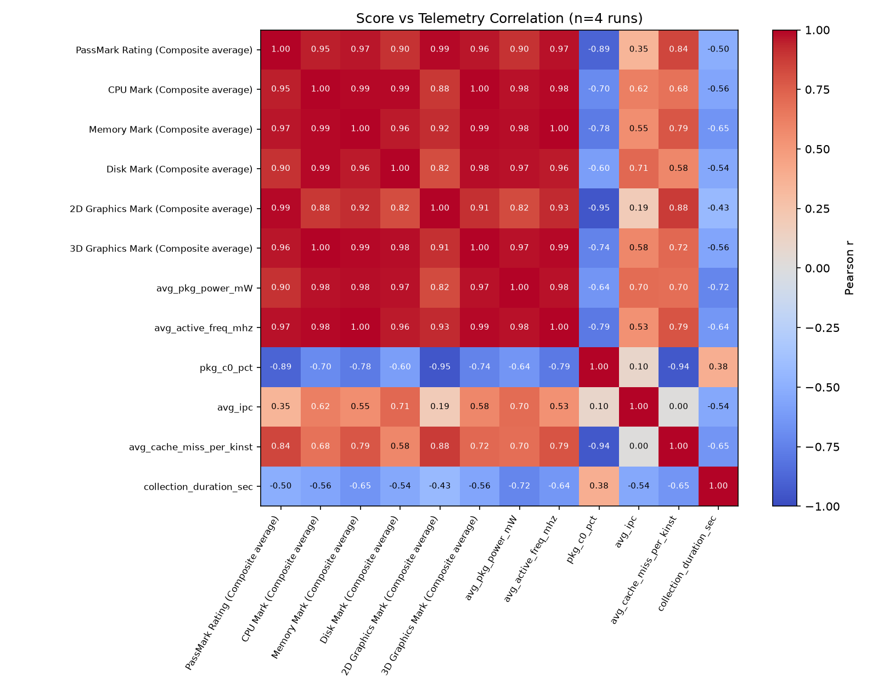

|                                      |   PassMark Rating (Composite average) |   CPU Mark (Composite average) |   Memory Mark (Composite average) |   Disk Mark (Composite average) |   2D Graphics Mark (Composite average) |   3D Graphics Mark (Composite average) |   avg_pkg_power_mW |   avg_active_freq_mhz |   pkg_c0_pct |   avg_ipc |   avg_cache_miss_per_kinst |   collection_duration_sec |
|:-------------------------------------|--------------------------------------:|-------------------------------:|----------------------------------:|--------------------------------:|---------------------------------------:|---------------------------------------:|-------------------:|----------------------:|-------------:|----------:|---------------------------:|--------------------------:|
| PassMark Rating (Composite average)  |                                  1    |                           0.95 |                              0.97 |                            0.9  |                                   0.99 |                                   0.96 |               0.9  |                  0.97 |        -0.89 |      0.35 |                       0.84 |                     -0.5  |
| CPU Mark (Composite average)         |                                  0.95 |                           1    |                              0.99 |                            0.99 |                                   0.88 |                                   1    |               0.98 |                  0.98 |        -0.7  |      0.62 |                       0.68 |                     -0.56 |
| Memory Mark (Composite average)      |                                  0.97 |                           0.99 |                              1    |                            0.96 |                                   0.92 |                                   0.99 |               0.98 |                  1    |        -0.78 |      0.55 |                       0.79 |                     -0.65 |
| Disk Mark (Composite average)        |                                  0.9  |                           0.99 |                              0.96 |                            1    |                                   0.82 |                                   0.98 |               0.97 |                  0.96 |        -0.6  |      0.71 |                       0.58 |                     -0.54 |
| 2D Graphics Mark (Composite average) |                                  0.99 |                           0.88 |                              0.92 |                            0.82 |                                   1    |                                   0.91 |               0.82 |                  0.93 |        -0.95 |      0.19 |                       0.88 |                     -0.43 |
| 3D Graphics Mark (Composite average) |                                  0.96 |                           1    |                              0.99 |                            0.98 |                                   0.91 |                                   1    |               0.97 |                  0.99 |        -0.74 |      0.58 |                       0.72 |                     -0.56 |
| avg_pkg_power_mW                     |                                  0.9  |                           0.98 |                              0.98 |                            0.97 |                                   0.82 |                                   0.97 |               1    |                  0.98 |        -0.64 |      0.7  |                       0.7  |                     -0.72 |
| avg_active_freq_mhz                  |                                  0.97 |                           0.98 |                              1    |                            0.96 |                                   0.93 |                                   0.99 |               0.98 |                  1    |        -0.79 |      0.53 |                       0.79 |                     -0.64 |
| pkg_c0_pct                           |                                 -0.89 |                          -0.7  |                             -0.78 |                           -0.6  |                                  -0.95 |                                  -0.74 |              -0.64 |                 -0.79 |         1    |      0.1  |                      -0.94 |                      0.38 |
| avg_ipc                              |                                  0.35 |                           0.62 |                              0.55 |                            0.71 |                                   0.19 |                                   0.58 |               0.7  |                  0.53 |         0.1  |      1    |                       0    |                     -0.54 |
| avg_cache_miss_per_kinst             |                                  0.84 |                           0.68 |                              0.79 |                            0.58 |                                   0.88 |                                   0.72 |               0.7  |                  0.79 |        -0.94 |      0    |                       1    |                     -0.65 |
| collection_duration_sec              |                                 -0.5  |                          -0.56 |                             -0.65 |                           -0.54 |                                  -0.43 |                                  -0.56 |              -0.72 |                 -0.64 |         0.38 |     -0.54 |                      -0.65 |                      1    |

## Strongest Score ↔ Telemetry Relationships

| Score | Telemetry | r | p-value | n |
|---|---|---|---|---|

| Memory Mark (Composite average) | avg_active_freq_mhz | 1.00 | 0.000 | 4 |

| 3D Graphics Mark (Composite average) | avg_active_freq_mhz | 0.99 | 0.009 | 4 |

| CPU Mark (Composite average) | avg_active_freq_mhz | 0.98 | 0.015 | 4 |

| Memory Mark (Composite average) | avg_pkg_power_mW | 0.98 | 0.020 | 4 |

| CPU Mark (Composite average) | avg_pkg_power_mW | 0.98 | 0.025 | 4 |

| PassMark Rating (Composite average) | avg_active_freq_mhz | 0.97 | 0.025 | 4 |

| 3D Graphics Mark (Composite average) | avg_pkg_power_mW | 0.97 | 0.029 | 4 |

| Disk Mark (Composite average) | avg_pkg_power_mW | 0.97 | 0.030 | 4 |

| Disk Mark (Composite average) | avg_active_freq_mhz | 0.96 | 0.044 | 4 |

| 2D Graphics Mark (Composite average) | pkg_c0_pct | -0.95 | 0.052 | 4 |

## Scatter Plots (Top 6 by |r|)

### Memory Mark (Composite average) vs avg_active_freq_mhz (r=1.00, p=0.000, n=4)

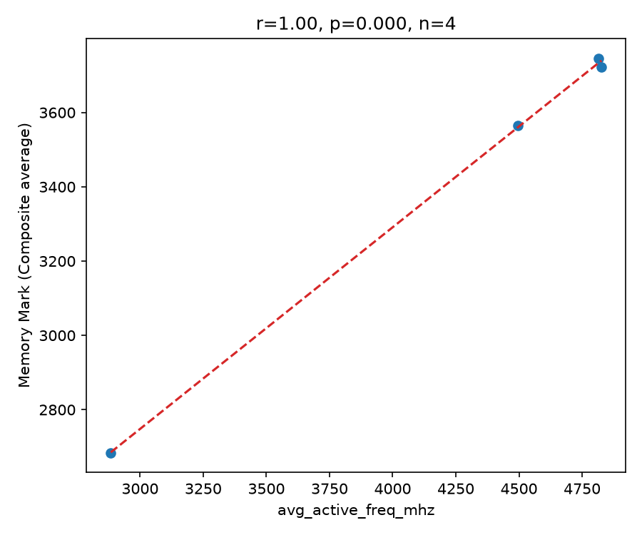

### 3D Graphics Mark (Composite average) vs avg_active_freq_mhz (r=0.99, p=0.009, n=4)

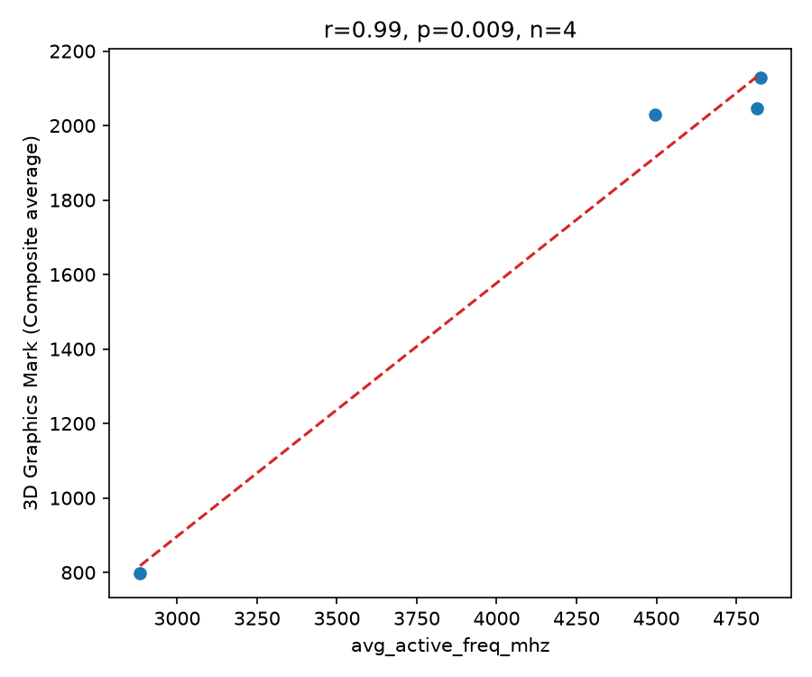

### CPU Mark (Composite average) vs avg_active_freq_mhz (r=0.98, p=0.015, n=4)

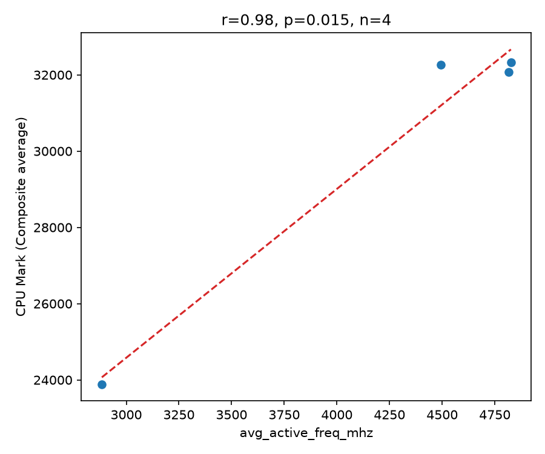

### Memory Mark (Composite average) vs avg_pkg_power_mW (r=0.98, p=0.020, n=4)

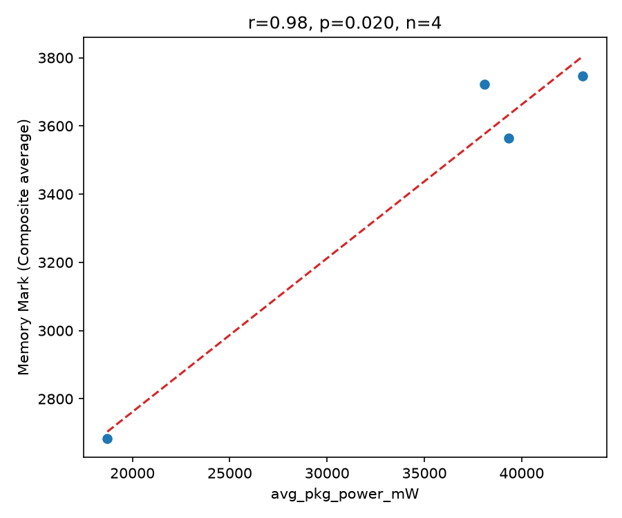

### CPU Mark (Composite average) vs avg_pkg_power_mW (r=0.98, p=0.025, n=4)

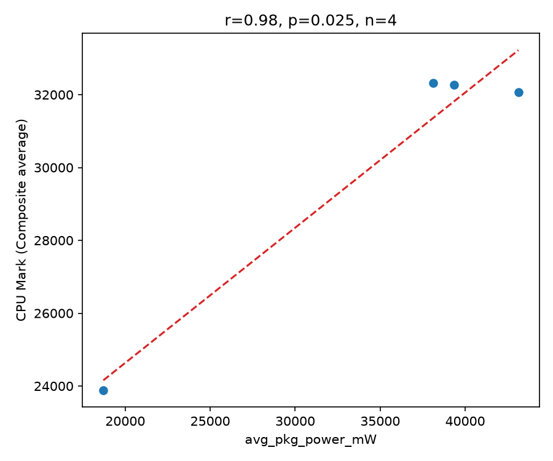

### PassMark Rating (Composite average) vs avg_active_freq_mhz (r=0.97, p=0.025, n=4)

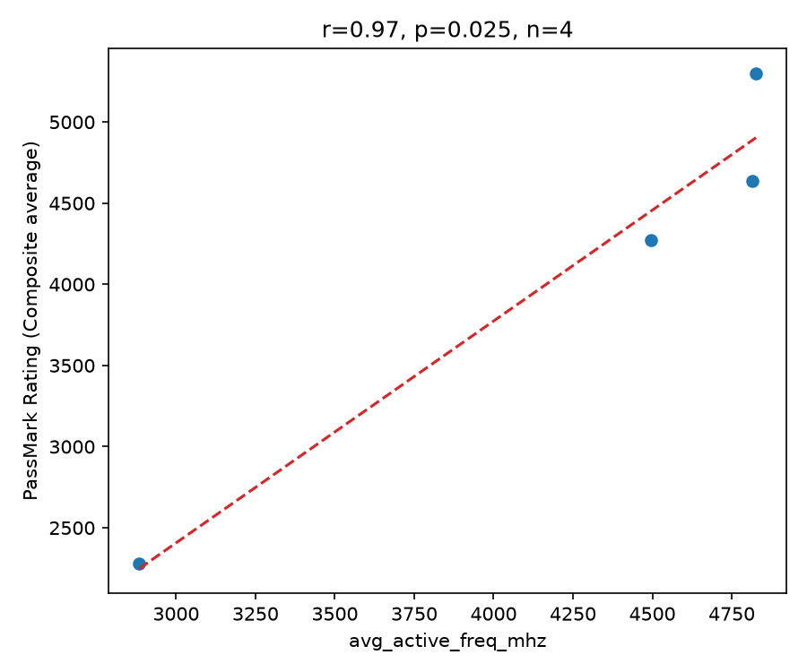

## How to Read This for SKU/Workload Behavior

- A **positive r between a score and average package power/frequency** suggests the workload scales with power/turbo headroom — i.e. the SKU is power- or frequency-limited for that sub-test, and raising power limits (PL1/PL2) or cooling should move the score.
- A **flat/near-zero r** suggests the sub-test is bound by something else telemetry here doesn't capture well (e.g., GPU-bound DirectX tests vs. CPU-only telemetry, disk I/O, memory latency) — look at `2D/3D Graphics Mark` vs CPU telemetry as the expected example of weak correlation.
- A **negative r with C0 residency** can indicate the benchmark finishes faster (less busy time / score) at higher scores, or that runs with more idle/background interference score lower — inspect the specific run rows, don't over-interpret from r alone.
- To get statistically solid conclusions: run more repeats per configuration, vary one knob at a time (e.g., PL1/PL2, frequency cap), and keep workload identical across runs.
