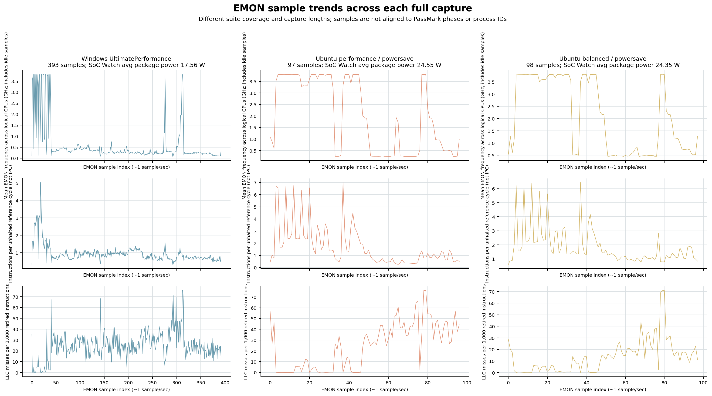
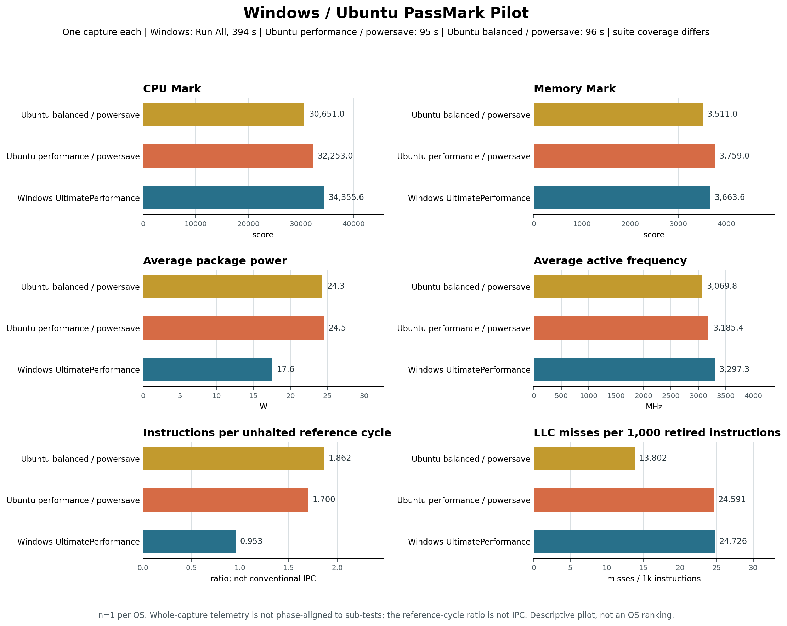

# Case Study: PassMark Workload and Telemetry on Windows and Linux

Same silicon (Intel Core Ultra 7 366H, Panther Lake), same board/BIOS, same
memory config, same EMON version (V11.61), run with this repo's sibling
project [`passmark-socwatch-emon-linux`](https://github.com/KhairulIzwan/passmark-socwatch-emon-linux).
PassMark is the workload and score source; SoC Watch and EMON provide
supporting measurements of platform behavior during the captures. The goal
is to describe the relationship between scores, power, frequency and CPU
activity under the tested configurations on Intel Core Ultra 7 366H.
This is an **exploratory case study**, not an OS ranking or a controlled
apples-to-apples benchmark - see [Caveats](#caveats--limitations).

- Windows source: [`telemetry_correlation_report/CoreUltra7_366H/SUMMARY.md`](telemetry_correlation_report/CoreUltra7_366H/SUMMARY.md)
- Linux source: [`CoreUltra7_366H/SUMMARY.md`](https://github.com/KhairulIzwan/passmark-socwatch-emon-linux/blob/main/reports/telemetry_correlation_report/CoreUltra7_366H/SUMMARY.md)

## Scope and workload equivalence

**The primary analyses examine PassMark results separately within Windows
and within Ubuntu.** A new one-iteration cross-OS pilot is reported separately
below as a limited observation, not an OS ranking or controlled comparison.
Scores are the starting point; SoC Watch and EMON provide context for each
workload capture. OS, scheduler and power-management mechanisms are later
research questions, not explanations established by the current observations.

Windows uses the GUI application; Ubuntu uses the Linux CLI build. This
interface difference alone does not prove that the underlying CPU/Memory
tests differ, but matching names such as CPU Mark and Memory Mark do not
prove equivalent work either. Sub-test algorithms, implementation, compiler
optimizations, threading, scoring and executed work have not been audited
for equivalence. Windows' overall PassMark Rating is not interchangeable
with the Linux CPU/Memory marks; different suite coverage or workload phases
can also affect whole-run telemetry.

The configurations are settings tested on this platform, not established
optima or proof of either OS's maximum achievable performance. Matching
power-profile names or limits would not establish workload equivalence.

## Reference-cycle metric correction

The metric previously labeled IPC is `INST_RETIRED.ANY /
CPU_CLK_UNHALTED.REF_TSC`: instructions per unhalted reference cycle, not
instructions per actual core cycle. Both OS analyzers use this same formula.
The archived EMON captures do not contain an actual-core-cycle counter, so
conventional IPC cannot be recovered from them or inferred from average
frequency. The displayed numbers are unchanged; their interpretation is corrected.

Derived CSV columns are now `instructions_per_ref_cycle` per core/sample and
`avg_instructions_per_ref_cycle` per run, replacing `ipc` and `avg_ipc`.
The run metric is the equal-weight mean over valid core/sample ratios, not
the ratio of summed instructions to summed reference ticks. Zero-reference
samples are unavailable and excluded from the mean. This metric is workload
context, not a conventional IPC or cross-OS efficiency measurement.

## Run selection

The current Windows analysis compares `HighPerformance` and
`UltimatePerformance`; `PowerSaver` is outside this stage's scope, not an
invalid result. Its scores and telemetry remain unchanged in the archive.
The Ubuntu comparison is limited to the `performance` profile with two CPU
governors: `powersave` and `performance`. Ubuntu `power-saver` is also outside
this stage's scope, with its archived data retained.

## Evidence and traceability

| Source | Evidence used here | Interpretation boundary |
|---|---|---|
| PassMark | CPU/Memory marks and exported sub-test scores | Describes the benchmark outcome, not the cause of a score difference |
| SoC Watch | Collection duration, average package power, active frequency and package C0 residency | Whole-capture behavior, not telemetry isolated to a CPU or Memory sub-test |
| EMON | Exported counters and derived instructions/ref cycle/cache metrics | Requires verified event definitions, aggregation and phase alignment before cross-OS interpretation |
| System information | Hardware, OS and recorded power settings | Configuration context, not proof that effective policies are equivalent |

Windows backing data lives in the [SKU archive](telemetry_correlation_report/CoreUltra7_366H/):
each run contains `PassMark_PerfRes.txt`, `socwatch.csv`, `emon.csv`,
`system_info.txt` and `analysis/emon_timeseries_tidy.csv`.
The [Linux SKU archive](https://github.com/KhairulIzwan/passmark-socwatch-emon-linux/tree/main/reports/telemetry_correlation_report/CoreUltra7_366H)
contains `results_console_all.yml`, `socwatch/socwatch.csv`, `emon.csv`,
`system_info.txt` and the tidy EMON CSV per run. Linux scores here use the
console-derived YAMLs; native PassMark YAML exports can be stale under
telemetry capture and are not the score authority for this comparison.

The [Windows analysis CSV](telemetry_correlation_report/CoreUltra7_366H/cross_run_analysis/combined_runs.csv)
and [Linux analysis CSV](https://github.com/KhairulIzwan/passmark-socwatch-emon-linux/blob/main/reports/telemetry_correlation_report/CoreUltra7_366H/cross_run_analysis/combined_runs.csv)
provide the per-run telemetry used below. They are derived data, not raw
captures. Score columns in a derived CSV should be checked against the
per-run score artifacts before reuse.

| OS / configuration | Run IDs |
|---|---|
| Windows `HighPerformance` | 20261103_213137 |
| Windows `UltimatePerformance` | 20261103_231839 |
| Linux `performance`, `powersave` governor | 20261104_073216, 20261104_080450, 20261104_081815 |
| Linux `performance`, `performance` governor | 20261104_075827, 20261104_081132, 20261104_082458 |

Raw data permits further investigation, but its presence
does not itself establish aligned workload phases or metric equivalence.
The inspected score export and SoC Watch summary do not identify individual
iteration boundaries; timestamped benchmark markers aligned with telemetry
would be needed to measure iteration or sub-test durations.

## Platform (shared)

| Item | Value |
|---|---|
| CPU | Intel Core Ultra 7 366H, 16 cores / 16 threads, 1 socket |
| Memory | 64 GB: 2 x 32 GB DDR5 SK Hynix @ 6400 MT/s |
| BIOS | PTLPFWI1.R00.3515.D56.2601280733 |
| EMON | V11.61 (both) |
| SoC Watch | v2026.2.0 (Windows) / v2026.2 pre-release (Linux) |
| Windows OS | Windows 11 Enterprise LTSC, Build 26100 |
| Linux OS | Ubuntu 24.04.5 LTS, Linux 6.18-intel |
| Windows power control | Whole power plan via `powercfg`; EPP/boost-setting queries were unsuccessful in this test setup |
| Linux power control | `powerprofilesctl` profile + `intel_pstate` governor (separate axes) |
| Windows test dates | 2026-11-03/04 |
| Linux test date | 2026-11-04 |

Windows used PassMark PerformanceTest 10.2; the Linux summary identifies the
CLI build but does not record its version. The runs use Short duration. The
Windows captures in scope used three iterations for HighPerformance and one
for UltimatePerformance; Ubuntu used three per run, per operator clarification.
These settings are operator-reported, not independently verified. Equivalence
of the benchmark builds, sub-tests and process/thread settings has not yet
been established.

### PassMark suite coverage

| OS | Suite selection | What the archived score export contains |
|---|---|---|
| Windows | Automation triggers PassMark's `Run All Tests` command | CPU, 2D graphics, 3D graphics, memory, disk, and overall Rating results |
| Ubuntu | Run command used `-r All` (`-r 3`) | CPU and Memory sub-test scores and marks in `results_console_all.yml` |

The recorded suite coverage differs: Windows' run includes graphics and disk
tests, while the archived Ubuntu score export contains CPU and Memory results.
Thus the Windows overall PassMark Rating and whole-capture telemetry include
workloads absent from the Ubuntu score export. This is another reason to keep
the OS analyses separate; even similarly named CPU/Memory marks do not prove
identical suite composition or sub-test implementation.

## Windows: PassMark observations

This stage compares the available `HighPerformance` and
`UltimatePerformance` captures. HighPerformance used three iterations and
UltimatePerformance one, per operator clarification; these settings are not
independently verified in the archived files. Treat this as a preliminary
comparison, not a matched repeatability test. Values come from each run's
PassMark export. Change is `100 * (UltimatePerformance / HighPerformance - 1)`,
calculated before rounding. Positive means the reported value is higher;
for memory latency, lower is better. Available RAM is capacity, not a score.

#### CPU scores

| Test / unit | HighPerformance (3 iterations) | UltimatePerformance (1 iteration) | Change |
|---|---|---|---|
| CPU Mark (composite) | 34163.7 | 34355.6 | +0.56% |
| Integer Math (MOps/s) | 89017.5 | 85488.8 | -3.96% |
| Floating Point Math (MOps/s) | 113777.3 | 112807.7 | -0.85% |
| Prime Numbers (million primes/s) | 366.9 | 366.5 | -0.11% |
| Extended Instructions SSE (million matrices/s) | 31979.3 | 31789.0 | -0.60% |
| Compression (KBytes/s) | 293334.0 | 316608.0 | +7.93% |
| Encryption (MBytes/s) | 25439.9 | 25348.6 | -0.36% |
| Physics (frames/s) | 2799.0 | 2792.8 | -0.22% |
| Sorting (thousand strings/s) | 37256.6 | 36706.3 | -1.48% |
| CPU Single Threaded (MOps/s) | 4461.4 | 4475.0 | +0.30% |
| Cross-platform Mark (composite) | 73334.2 | 71695.4 | -2.23% |

#### Memory results

| Test / unit | HighPerformance (3 iterations) | UltimatePerformance (1 iteration) | Change |
|---|---|---|---|
| Memory Mark (composite) | 3721.9 | 3663.6 | -1.57% |
| Database Operations (KOps/s) | 7415.4 | 6884.7 | -7.16% |
| Memory Read Cached (MBytes/s) | 35938.7 | 35860.4 | -0.22% |
| Memory Read Uncached (MBytes/s) | 20111.3 | 19848.9 | -1.30% |
| Memory Write (MBytes/s) | 16200.4 | 16200.4 | +0.00% |
| Available RAM (MB; capacity) | 53878.5 | 53700.5 | -0.33% |
| Memory Latency (ns; lower is better) | 40.3 | 41.3 | +2.48% |
| Memory Threaded (MBytes/s) | 90229.8 | 89699.4 | -0.59% |

The composite CPU and Memory Marks are close in these captures: about 0.6%
and 1.6% apart. Some sub-tests differ more; for example, Compression is
7.9% higher under UltimatePerformance while Integer Math is 4.0% lower.
The telemetry shows whole-run average package power of 17.9 W versus 17.6 W,
active frequency of 3307 versus 3297 MHz, and package C0 residency of 75.33%
versus 73.67%. These observations do not establish that the plans are
equivalent or explain the score results. Windows PowerSaver is outside this
stage's scope; its raw scores and telemetry remain in the archive unchanged.

## Ubuntu: PassMark observations

Reference: `performance` profile with the `powersave` governor. Performance
rows are equal-weight means of three independent captures, not pooled
telemetry samples. Both groups use the same power profile; only the selected
governor differs. Scores use the console-derived YAMLs; telemetry uses the
analysis CSV values, averaged before rounding. Package power is converted
from mW to W.

| Configuration | Runs | CPU Mark | Memory Mark | Avg pkg power | Avg active freq | instructions/ref cycle |
|---|---|---|---|---|---|---|
| `performance` profile, `powersave` governor | 3 | 30732 | 3772 | 21.6 W | 2947 MHz | 1.63 |
| `performance` profile, `performance` governor | 3 | 29891 | 3763 | 21.6 W | 2932 MHz | 1.58 |

### Score observations

The following tables are calculated directly from the console-derived YAMLs
for the two run groups listed above. Both use the `performance` profile;
the column headers identify each CPU governor. Change is
`100 * (performance-governor mean / powersave-governor mean - 1)`, using
unrounded means. Displayed scores and changes are rounded to one decimal place.

Field names are retained because these YAMLs do not declare units; no
cross-OS field equivalence or unit conversion is assumed. The tables cover
fields present in every included score export. Missing fields are unavailable,
not zero; for example, the supplied `20261104_082458` export does not record
memory latency. Per-run values remain available in the linked SKU archive.

#### CPU scores

| Exported field | performance profile / powersave governor (reference mean) | performance profile / performance governor (mean) | Change vs reference |
|---|---|---|---|
| `SUMM_CPU` | 30731.7 | 29891.3 | -2.7% |
| `CPU_INTEGER_MATH` | 90520.7 | 90404.7 | -0.1% |
| `CPU_FLOATINGPOINT_MATH` | 103624.0 | 103981.3 | +0.3% |
| `CPU_PRIME` | 195.7 | 173.3 | -11.4% |
| `CPU_SORTING` | 38567.0 | 37075.0 | -3.9% |
| `CPU_ENCRYPTION` | 24675.0 | 23865.7 | -3.3% |
| `CPU_COMPRESSION` | 274128.7 | 267527.7 | -2.4% |
| `CPU_SINGLETHREAD` | 4412.3 | 4393.3 | -0.4% |
| `CPU_PHYSICS` | 3203.0 | 2700.7 | -15.7% |
| `CPU_MATRIX_MULT_SSE` | 17365.0 | 17117.3 | -1.4% |

#### Memory results

| Exported field | performance profile / powersave governor (reference mean) | performance profile / performance governor (mean) | Change vs reference |
|---|---|---|---|
| `SUMM_ME` | 3772.0 | 3762.7 | -0.2% |
| `ME_ALLOC_S` | 9434.0 | 7363.0 | -22.0% |
| `ME_READ_S` | 35379.3 | 35604.7 | +0.6% |
| `ME_READ_L` | 23505.0 | 23570.0 | +0.3% |
| `ME_WRITE` | 16342.3 | 16367.3 | +0.2% |
| `ME_LARGE` | 57677.0 | 57657.3 | -0.0% |

The displayed -0.0% for `ME_LARGE` is a small negative change rounded to one
decimal place, not a missing value.

- With the performance profile unchanged, the performance-governor group
  records ~2.7% lower CPU Mark and similar Memory Mark. The cause is not
  established; the governor's name does not predict the benchmark outcome.
- Repeated CPU Marks within each performance configuration agree within
  ~0.4%. This describes the observed repeatability of these groups, not a
  guarantee for other configurations or workloads.
- The performance-governor group's near-flat Integer Math and Floating Point
  Math accompany lower Physics, Prime Numbers and `ME_ALLOC_S` results.
  A composite score alone would hide this mixed response; the table does
  not establish why those fields changed.

### Supporting telemetry

Both groups round to 21.6 W average package power, with average active
frequencies of 2947 MHz for the powersave governor and 2932 MHz for the
performance governor. Package C0 residency remains near 99%. These are
whole-capture observations, not proof of identical power behavior during
each sub-test or a causal explanation for the score differences.
instructions/ref cycle is retained as workload context within Ubuntu, not an OS ranking metric.

## Next investigation

The available CPU and memory score comparisons are presented above; no new
runs or iteration timestamps were required to calculate them. Next inspect
per-run variation and existing EMON/SoC Watch traces around the results that
stand out, without assigning telemetry segments to named sub-tests unless
timing evidence supports that assignment. Missing export fields do not prove
that a test was not executed. Matching names do not prove cross-OS equivalence.

### Collect additional evidence only where needed

The inspected score exports do not contain per-iteration scores or sub-test
start/end timestamps. A telemetry trace alone does not establish those
boundaries, and collection duration is not a phase marker. Check the existing
artifacts for usable alignment evidence before requesting new collection.

If phase markers are absent, new timestamped iteration/sub-test markers
aligned with SoC Watch and EMON would be needed for sub-test-specific telemetry
attribution. Independent repeat runs address a different gap: repeatability
of the score differences. Neither is a prerequisite for describing the
sub-test scores already archived.

Only after that should OS, power-policy, scheduler or compiler mechanisms be
investigated as possible explanations. The separate pilot below is a
descriptive score comparison only; it does not establish workload equivalence,
attribute differences to an OS mechanism, or rank the operating systems.

## Exploratory cross-OS pilot: one iteration each

This is a first, limited score comparison between Windows UltimatePerformance
run `20261103_231839` and the Ubuntu `performance` profile / `powersave`
governor run `20261110_025123`, with a second Ubuntu run using the `balanced`
profile / `powersave` governor (`20261110_084903`). All three captures were
reported as Short duration, one iteration and 16 CPU test processes. Windows
used PerformanceTest 10.2 and
`Run All Tests`; the Ubuntu CLI build version is not recorded and was invoked
with `-r All`. The Windows export contains CPU, graphics, memory and disk
results, while Ubuntu's console-derived export contains CPU and memory results.
Only the common CPU and Memory Marks are shown here; extracting these score
fields does not make the executed suites or sub-tests equivalent. The Windows
automation always launches `Run All Tests` and has no suite selector, so this
capture's telemetry duration/power/frequency cannot be split into CPU/Memory
versus graphics/disk portions after the fact.

Both run snapshots identify the CPU as Intel Core Ultra 7 366H (16 cores / 16
threads). The Ubuntu pilot's local `passmark_console_raw.log` records its
observed order: CPU tests (Integer Math, Floating Point, Prime Numbers,
Sorting, Encryption, Compression, Single Threaded, Physics, SSE), followed
by Memory tests (Database Operations, cached/uncached reads, Write, Available
RAM, Latency, Threaded). The Windows archive has the final
`PassMark_PerfRes.txt` score listing but no comparable per-test execution
timeline; its listing order is not treated as run order. Therefore, the
sub-test sequence cannot currently be compared across operating systems.
The Ubuntu PassMark console banner reports "14 cores @ 3800 MHz", while that
run's OS snapshot and SoC Watch report 16 online logical CPUs / 16 cores and
the command used 16 test processes. A separate [PassMark topology probe log](https://github.com/KhairulIzwan/passmark-socwatch-emon-linux/tree/main/reports/telemetry_correlation_report/CoreUltra7_366H/20261110_025123/topology_probe)
reports 16 logical CPUs, one thread per core, four logical P-cores and 12
logical E-cores, but sets `logical_per_pcore=2`. This is consistent with the
14-core banner if the four logical P-cores are divided by two and then added
to the 12 E-cores. Most CPU tests in that probe ran on 16 threads, but
`Primes Cross Platform` ran on 14. This points to PassMark's topology/thread
heuristic as the source of the displayed count; the OS still reports 16
online CPUs. The precise vendor-side cause remains unverified.

| PassMark score | Windows UltimatePerformance | Ubuntu performance / powersave | Ubuntu balanced / powersave | Performance Ubuntu vs. Windows | Balanced Ubuntu vs. Windows |
|---|---:|---:|---:|---:|---:|
| CPU Mark | 34355.6 | 32253.0 | 30651.0 | -6.12% | -10.78% |
| Memory Mark | 3663.6 | 3759.0 | 3511.0 | +2.60% | -4.17% |

These are one capture per configuration, not repeatable estimates. The Ubuntu
performance/powersave CPU Mark is 4.95% above the mean of the earlier
three-iteration runs; the balanced/powersave CPU Mark is 0.26% below that mean.
Keep both one-iteration results separate from the earlier three-iteration mean.
These differences call for repeat matched one-iteration runs; they do not show
that either earlier or current result is wrong.

### Whole-capture telemetry context

| SoC Watch measure | Windows UltimatePerformance | Ubuntu performance / powersave | Ubuntu balanced / powersave |
|---|---:|---:|---:|
| Average package power | 17.56 W | 24.55 W | 24.35 W |
| Average active frequency | 3297 MHz | 3185 MHz | 3070 MHz |
| Collection duration | 394.162 s | 95.001 s | 95.982 s |

These summaries cover the complete captures, not matched PassMark sub-test
phases. Windows took 394.162 s and the Ubuntu runs 95.001 and 95.982 s.
Windows' additional
graphics and disk tests plausibly contribute to the longer capture, but these
whole-run measurements cannot quantify their contribution or establish the
CPU/Memory-only duration. Suite coverage and capture duration differ, so
power and frequency are context only; they do not explain the score difference
or establish energy efficiency. Both Ubuntu SocWatch logs report unsupported-
feature warnings, although their outputs contain power and frequency summaries.
Validate that telemetry configuration before relying on it.

### EMON context: whole-capture counters

| EMON-derived measure | Windows UltimatePerformance | Ubuntu performance / powersave | Ubuntu balanced / powersave |
|---|---:|---:|---:|
| Samples | 393 | 97 | 98 |
| Instructions per unhalted reference cycle | 0.9532 | 1.6995 | 1.8625 |
| LLC misses per 1,000 retired instructions | 24.726 | 24.591 | 13.802 |
| Mean frequency across logical CPU/sample rows, including idle samples | 0.592 GHz | 2.006 GHz | 2.084 GHz |

The plot shows changes across each full capture, not per-process or per-test
behavior. EMON samples have no PassMark test/process IDs, while the archived
SoC Watch CSV provides whole-capture summaries and aggregate process activity,
not a time-aligned power/frequency series. Thus, visible transitions cannot be
reliably assigned to CPU, memory, graphics, disk, or an individual process.
That requires synchronized PassMark phase markers and process-aware telemetry.

These are whole-capture averages using the same named EMON events, but over
different sample counts and suite compositions. The instructions/reference-cycle
ratio is not conventional IPC; actual core-cycle counters are absent. The
idle-inclusive EMON frequency average is not SoC Watch's active-only frequency
and is sensitive to how much of each capture each logical CPU was idle. These
metrics are descriptive context, not per-sub-test attribution or an OS ranking.

Sources: [Windows score export](telemetry_correlation_report/CoreUltra7_366H/20261103_231839/PassMark_PerfRes.txt),
[Windows SoC Watch capture](telemetry_correlation_report/CoreUltra7_366H/20261103_231839/socwatch.csv),
[Ubuntu performance pilot](https://github.com/KhairulIzwan/passmark-socwatch-emon-linux/tree/main/reports/telemetry_correlation_report/CoreUltra7_366H/20261110_025123),
[Ubuntu balanced pilot](https://github.com/KhairulIzwan/passmark-socwatch-emon-linux/tree/main/reports/telemetry_correlation_report/CoreUltra7_366H/20261110_084903).
The aggregate pilot chart is generated by [plot_cross_os_pilot.py](plot_cross_os_pilot.py).

## Caveats / limitations

- **Not a controlled single-script comparison** - two independent repos, run
  on different dates, with different harness implementations
  (`run_combined_test.ps1` vs `run_combined_test.sh`) and partially different
  SoC Watch versions (pre-release vs release).
- **Iteration counts differ across captures.** The primary Windows runs used
  three (HighPerformance) and one (UltimatePerformance) iteration; the primary
  Ubuntu governor groups used three per run. The new pilot uses one iteration
  on each OS. These counts are operator-reported and not recorded in the
  archived run metadata. Capture duration does not provide per-iteration
  timings or eliminate thermal/workload-phase differences.
- **Repeatability is limited.** The primary Windows plans each have one capture;
  the primary Ubuntu governor groups have three captures each. The cross-OS
  pilot has one capture per configuration. Ubuntu's repeated performance-profile CPU Marks
  agree within ~0.4%, but this does not establish repeatability for the pilot
  or Windows captures.
- **instructions/ref cycle comparability is unverified** (see above): EMON event definitions,
  aggregation and collection windows have not been aligned.
- Conclusions here are **directional observations for further investigation**,
  not a certified OS power-efficiency comparison.

## Updating this case study

Use the existing SKU archives and per-run score exports to extend the
within-OS analysis, then update the tables above by hand; this file is not
auto-generated. When new runs are available, regenerate their analysis from
`Results/` and refresh the relevant SKU archive and summary. For the current
Windows comparison, include runs `20261103_213137` (HighPerformance) and
`20261103_231839` (UltimatePerformance); leave `20261103_233441` (PowerSaver)
out of the analysis without modifying its archived files. The included Windows
captures use three versus one iteration, so treat the close composite scores
as preliminary. A matched comparison would require rerunning one plan at the
other's iteration count and recording invocation settings. Record iteration/
sub-test timestamps if telemetry is to be aligned to individual workload
phases. The Ubuntu governor comparison remains a separate within-OS analysis.
Before a controlled follow-up comparison, verify benchmark versions and
sub-test implementations, scoring and suite coverage, process/thread counts,
effective power settings, matched telemetry
start/stop windows and EMON event definitions. Repeat every configuration
under comparable thermal/background conditions and record energy over the
same workload if making an energy-efficiency claim.
