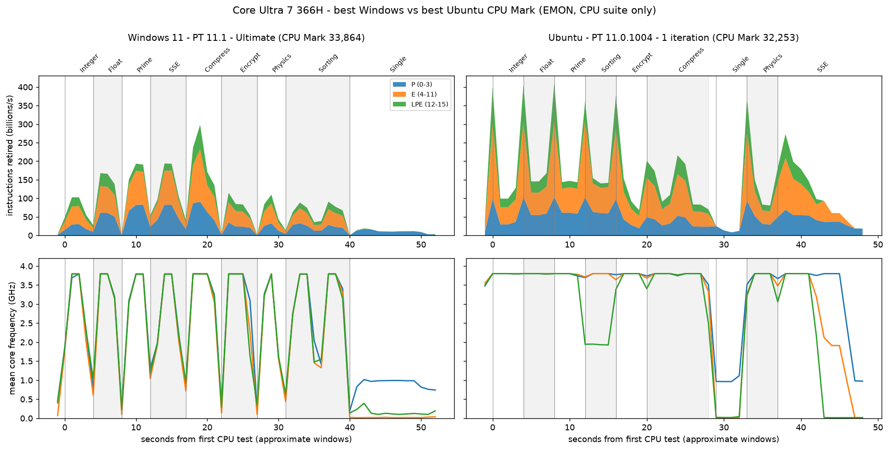

# Windows vs. Ubuntu: Best PassMark Score (Core Ultra 7 366H)

Short comparison of the **best PassMark score each OS reached** on this SKU
(Intel Core Ultra 7 366H, Panther Lake, same board/BIOS/memory). Scores only,
with a CPU sub-test breakdown. For the wider exploratory study (telemetry,
caveats) see [CASE_STUDY_WINDOWS_VS_LINUX.md](CASE_STUDY_WINDOWS_VS_LINUX.md).

## Runs compared

| | Windows | Ubuntu |
|---|---|---|
| Run | [`20261110_191135`](telemetry_correlation_report/CoreUltra7_366H/20261110_191135/) | [`20261110_025123`](https://github.com/KhairulIzwan/passmark-socwatch-emon-linux/tree/main/reports/telemetry_correlation_report/CoreUltra7_366H/20261110_025123) |
| Configuration | `UltimatePerformance` power plan | `performance` profile, `powersave` governor |
| PassMark | PerformanceTest **11.1** | PerformanceTest Linux **11.0.1004** (from its topology-probe log) |
| Iterations / processes | 1 / 16 | 1 / 16 |
| Duration setting | Short | Short |
| Suite run | Run All Tests (CPU, 2D, 3D, Memory, Disk) | `-r All` (CPU, Memory) |

Both are the best score of their OS at the same PassMark major version (11.x)
and iteration count. Windows `HighPerformance` (11.1) is within 0.1% of
`UltimatePerformance`, so the choice between them does not change the result.

## Best score

| Score | Windows | Ubuntu | Ubuntu vs. Windows |
|---|---:|---:|---:|
| CPU Mark | 33,864.4 | 32,253.0 | -4.76% |
| Memory Mark | 3,724.6 (3,727.0 with `HighPerformance`) | 3,759.0 | +0.9% |

Other results for context (not like-for-like):

- Windows on PassMark 10.2 scored up to 34,355.6 CPU Mark (`UltimatePerformance`),
  so the CPU Mark gap is 6.1% against 10.2 and 4.8% against 11.1; part of it is
  the PassMark version.
- Ubuntu's best Memory Mark was 3,790 (three-iteration run, Nov 4), +1.7% vs.
  Windows' best 3,727.

## CPU sub-tests

Order is each OS's run order. Ubuntu's is from its results file and console log.
Windows' is the exported listing order, which EMON supports (Single Threaded
runs last).

| Test | Windows order | Ubuntu order | Windows | Ubuntu | Ubuntu vs. Windows |
|---|---:|---:|---:|---:|---:|
| Integer Math | 1 | 1 | 86,973 | 90,872 | +4.5% |
| Floating Point | 2 | 2 | 112,869 | 108,925 | -3.5% |
| Prime Numbers | 3 | 3 | 366.1 | 271 | -26.0% |
| SSE (matrix) | 4 | 9 | 32,024 | 17,666 | -44.8% |
| Compression | 5 | 6 | 291,922 | 277,356 | -5.0% |
| Encryption | 6 | 5 | 25,358 | 24,925 | -1.7% |
| Physics | 7 | 8 | 2,791 | 3,271 | +17.2% |
| Sorting | 8 | 4 | 36,606 | 47,310 | +29.2% |
| Single Threaded | 9 | 7 | 4,466 | 4,456 | -0.2% |
| **CPU Mark** | | | **33,864** | **32,253** | **-4.76%** |

## Memory sub-tests

Same two runs as the best score above. Ubuntu's results file uses short keys;
the mapping to PassMark's names is inferred from the values (`ME_READ_S` =
Read Cached, `ME_READ_L` = Read Uncached).

| Test | Unit | Windows | Ubuntu | Ubuntu vs. Windows |
|---|---|---:|---:|---:|
| Read - Cached | MB/s | 35,943 | 34,742 | -3.3% |
| Read - Uncached | MB/s | 20,046 | 21,713 | +8.3% |
| Write | MB/s | 16,179 | 16,306 | +0.8% |
| Latency | ns (lower is better) | 41.2 | 41.0 | 0.5% better |
| Threaded | MB/s | 89,707 | 90,968 | +1.4% |
| **Memory Mark** | | **3,724.6** | **3,759.0** | **+0.9%** |

Memory is within about 3% on four of five tests; only Read - Uncached differs
more (+8.3%). Ubuntu also reports Available RAM and large-block values
(`ME_ALLOC_S`, `ME_LARGE`) that this Windows results file does not list, so
they are not compared. The Memory Mark is a composite of the sub-tests, so these
differences stay small in the total.

## SKU core topology

Intel Core Ultra 7 366H (Panther Lake): 16 cores / 16 threads, no Hyper-Threading
(1 thread per core), as reported by EMON.

| Core type | Count | Architecture |
|---|---:|---|
| P-core | 4 | Cougar Cove |
| E-core | 8 | Darkmont |
| LPE-core (low-power E) | 4 | Darkmont |
| **Total** | **16** | |

The Ubuntu PassMark probe reports 4 logical P-cores and 12 logical E-cores
(the 8 E and 4 LPE cores counted together) and sets `logical_per_pcore = 2`,
so it computes 4/2 + 12 = **14 cores** and runs Prime Numbers on 14 threads
instead of 16. The OS and EMON still report all 16 cores online.

## Reading the result

- Windows' CPU Mark is about 4.8% higher. Memory Mark is about equal (within 1%).
- Single Threaded, Encryption and Compression are within 5% of each other.
- **Prime Numbers** is 26% lower on Ubuntu. It runs on 14 of 16 cores there
  (see topology above), but that is only 12.5% fewer threads, so thread count
  alone does not explain a 26% gap. EMON (below) shows the clocks are not
  lower and all 16 cores are active, but P-core IPC is about 27% lower. Why
  is not established.
- **SSE** (-44.8%) and **Sorting** (+29.2%) differ most and swap positions in
  the run order, so run order may contribute (for example, through where each
  test falls relative to the PL2 = 65 W / PL1 = 25 W power-limit behavior).
  This is a hypothesis only; Ubuntu has no per-second power data to test it.

## EMON per-second view (CPU suite only)

Script: [plot_best_score_emon.py](plot_best_score_emon.py). Instructions retired
(top) and mean frequency (bottom) are split by core type: P = cores 0-3,
E = 4-11, LPE = 12-15 (inferred from the IPC pattern). The shaded test windows
are approximate, read from activity transitions, not recorded by PassMark.
SocWatch only provides whole-run summaries in these captures, so it is used for
the power-limit counts in the limits below, not for the per-second plot.

Busy seconds only (P-cores at 3.5 GHz or higher, start-of-test spike and
ramp/tail seconds removed; 1 to 5 seconds per test, so indicative):

| Test | Score delta | Mean GHz, all cores (Win / Ubu) | P-core IPC (Win / Ubu) | IPC delta |
|---|---:|---|---|---:|
| Integer | +4.5% | 3.78 / 3.80 | 1.99 / 2.10 | +5.5% |
| Floating Point | -3.5% | 3.79 / 3.80 | 4.02 / 3.70 | -8.0% |
| Prime Numbers | -26.0% | 3.79 / 3.79 | 5.44 / 3.98 | -26.8% |
| SSE | -44.8% | 3.79 / 3.70 | 5.44 / 3.53 | -35.1% |
| Compression | -5.0% | 3.79 / 3.75 | 5.28 / 2.99 | -43.4% |
| Encryption | -1.7% | 3.79 / 3.80 | 1.81 / 2.32 | +28.2% |
| Physics | +17.2% | 3.79 / 3.80 | 2.15 / 2.47 | +14.9% |
| Sorting | +29.2% | 3.79 / 3.18 | 1.81 / 4.01 | +121.5% |

What it shows:

- **Clocks are not the gap.** In busy seconds both OSes hold the P-cores at
  about 3.8 GHz, including during Prime and SSE.
- **Prime Numbers:** all 16 cores are active on Ubuntu (so the 14-thread
  setting is not visible as idle cores), but P-core IPC is 27% lower, in line
  with the 26% score gap. IPC also tracks the score direction for Integer,
  Floating Point, SSE and Physics.
- **IPC does not track the score** for Compression, Encryption and Sorting, so
  window boundaries or a different instruction mix are likely involved.
  Treat IPC as a clue, not an explanation.
- **Run structure differs.** Windows shows about 1 s idle gaps between tests;
  Ubuntu runs them back to back, with a roughly 400 B instructions/s spike in
  the first second of each test (consistent with a warm-up spin-wait; not
  confirmed).
- **Ubuntu Sorting:** the LPE cores run at about 1.9 GHz while P and E stay at
  3.8 GHz. Sorting still scores +29%.
- **Ubuntu SSE** ends with a long tail where E and LPE cores finish and clock
  down before the P-cores, so the last seconds use few cores.

## SocWatch whole-run power summary (same suites)

Windows was rerun on CPU and Memory only (1 iteration, Short,
`UltimatePerformance`; CPU Mark 33,693.5, Memory Mark 3,730.0) so it matches
the Ubuntu coverage. Archived in
[`cpu_memory_only/`](cpu_memory_only/CoreUltra7_366H/20261111_191425/). Its
`PassMark_PerfRes.txt` also lists 2D, 3D and Disk values; those are carried over
from earlier runs, not measured. Configured limits are the same on both OSes:
PL1 = 25 W, PL2 = 65 W, Tau = 28 s.

| | Windows (CPU+Memory only) | Ubuntu (CPU+Memory) | Windows (full suite, for reference) |
|---|---|---|---|
| Average package power | 22.1 W | 24.5 W | 16.2 W |
| Capture length | about 104 s | about 95 s | about 411 s |
| PBM-PL1 samples | 12.9% | 24.5% | 3.0% |

The first two columns cover the same suites and are comparable; the full-suite
column is diluted by the low-power 2D, 3D and Disk tests. The PBM-PL1 share is
higher on Ubuntu. Capture lengths are close. Ubuntu has no per-second power
trace, so power cannot be tied to individual sub-tests.

## Limits

- One run per OS; no repeatability estimate. Ubuntu's repeated three-iteration
  runs agree within about 0.4%.
- The PassMark builds are the same major version but not identical
  (Windows 11.1, Linux 11.0.1004), and Windows is a GUI build while Linux is the CLI.
- Sub-test names match but equivalence of the work done is not audited. The
  builds differ in at least thread selection (Prime on 14 vs 16 threads) and
  version, so identical workload code is not confirmed; only PassMark can
  confirm that.
- Windows run order is inferred (listing order plus EMON), not recorded.
- The EMON test windows are approximate and the IPC figures use few seconds per
  test.
- The Windows capture in the best-score run covers the whole suite and Ubuntu
  CPU and Memory only, so only CPU-suite seconds are compared there. The
  power section uses the matched CPU+Memory-only Windows run instead.
- EMON starts about 4 s before SocWatch, so SocWatch missed the Integer test
  in the CPU+Memory-only run; the SocWatch trace is aligned to EMON by
  correlation (within about 1 s).
- Ubuntu's PassMark version is recorded for `20261110_025123` only; other Ubuntu
  runs do not archive it.

Sources: [Windows scores](telemetry_correlation_report/CoreUltra7_366H/20261110_191135/PassMark_PerfRes.txt),
[Ubuntu scores](https://github.com/KhairulIzwan/passmark-socwatch-emon-linux/blob/main/reports/telemetry_correlation_report/CoreUltra7_366H/20261110_025123/results_console_all.yml),
[Ubuntu version log](https://github.com/KhairulIzwan/passmark-socwatch-emon-linux/blob/main/reports/telemetry_correlation_report/CoreUltra7_366H/20261110_025123/topology_probe/PerformancetestDebug.log).
