# Telemetry ↔ PassMark Score Correlation Report

Generated from `reports\telemetry_correlation_report\CoreUltra7_366H` — 3 runs with usable data (PassMark + SoCWatch, EMON).

## Test-Bed Configuration

- **CPU**: Intel(R) Core(TM) Ultra 7 366H

- **Cores/Threads**: 16 cores / 16 threads

- **Memory**: 64 GB across 2 module(s)

- **BIOS**: PTLPFWI1.R00.3515.D56.2601280733

- **GPU**: Intel(R) Graphics - driver 32.0.101.8357 (12/01/2025 16:00:00)

- **Power plan**: varies per run (3 plans tested: HighPerformance, PowerSaver, UltimatePerformance) — see breakdown below.

## Methodology

- **PassMark** supplies one composite/sub-test score per run (`PassMark_PerfRes.txt`), not a time series.
- **SoCWatch** (`socwatch.csv`) supplies whole-run summary telemetry: average package power (mW), average active CPU frequency excluding idle time (MHz), and package C-state residency (% time in ACPI C0 = active).
- **EMON** (`emon.csv`), where present, supplies ~1-sample/sec counters across the full run; these were averaged into run-level IPC and last-level-cache-miss-rate metrics.
- Each **run becomes one observation**; correlation (Pearson r) is computed **across runs** between score metrics and telemetry metrics — this is the only valid level for score correlation since PassMark itself has no internal time resolution.
- ⚠️ **Caveat**: with **n=3** runs on a single SKU/system (one run per power plan), these are exploratory correlations, not statistically robust conclusions:
  - Each PassMark score is itself already an average across the run's internal **3 iterations**, so the *score* values have reasonably low pure benchmark-noise.
  - However, **telemetry (SoCWatch/EMON) was captured once per run**, not separately per iteration — so we don't know iteration-to-iteration telemetry variance (e.g., thermal ramp across the 3 iterations), and runs were executed back-to-back without controlling for thermal/background-state carryover between power-plan switches.
  - With only n=4 distinct conditions, a single atypical plan can dominate the fit — p<0.05 here should be read as a credible **directional** signal worth acting on, not a finalized regression. Confirming with 1-2 repeat runs per plan (especially for any plan that looks like an outlier) would turn this from directional into robust.

## Per-Run Summary Table

|             run | power_plan          |   PassMark Rating (Composite average) |   CPU Mark (Composite average) |   Memory Mark (Composite average) |   Disk Mark (Composite average) |   2D Graphics Mark (Composite average) |   3D Graphics Mark (Composite average) |   avg_pkg_power_mW |   avg_active_freq_mhz |   pkg_c0_pct |   avg_ipc |   avg_cache_miss_per_kinst |   collection_duration_sec |
|----------------:|:--------------------|--------------------------------------:|-------------------------------:|----------------------------------:|--------------------------------:|---------------------------------------:|---------------------------------------:|-------------------:|----------------------:|-------------:|----------:|---------------------------:|--------------------------:|
| 20261103_213137 | HighPerformance     |                                6427   |                        34163.7 |                            3721.9 |                         35885.3 |                                  713.6 |                                 4226.6 |            17945.2 |               3306.94 |        75.33 |      1.01 |                      20.47 |                   1186.1  |
| 20261103_231839 | UltimatePerformance |                                6315.2 |                        34355.6 |                            3663.6 |                         41849.9 |                                  693.3 |                                 4173.5 |            17562.9 |               3297.31 |        73.67 |      0.95 |                      24.73 |                    394.16 |
| 20261103_233441 | PowerSaver          |                                5121   |                        33906.2 |                            2966.3 |                         40235.7 |                                  524.9 |                                 4128.3 |            13823.8 |               2898.75 |        88.97 |      0.78 |                      29.5  |                    402.07 |

## Per-Run Detailed Plots (Side-by-Side by Plot Type)

Each completed run also has its own 4-plot deep-dive (generated by `analyze_run.py` / `analyze_all.py`), covering within-run telemetry trends that the cross-run tables above don't show. Grouped here by plot type so runs/power plans can be compared side by side; click/open an image for full resolution.

### Timeseries overview (freq / IPC / cache-miss)

<table><tr>

<td align="center"><b>20261103_213137 HighPerformance</b> 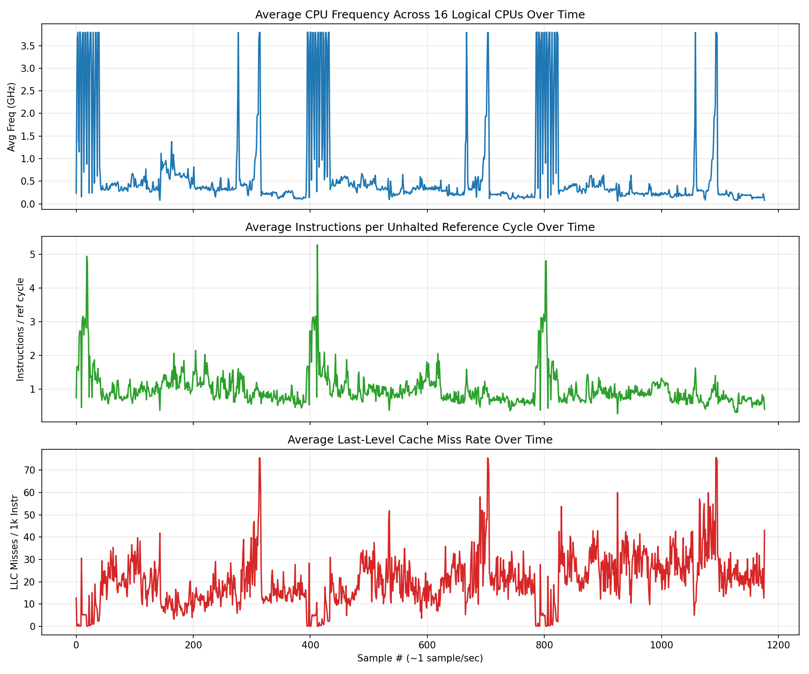</td>

<td align="center"><b>20261103_231839 UltimatePerformance</b> 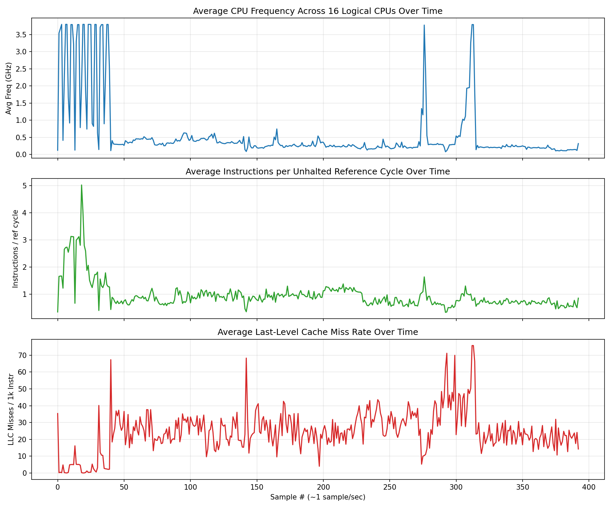</td>

<td align="center"><b>20261103_233441 PowerSaver</b> 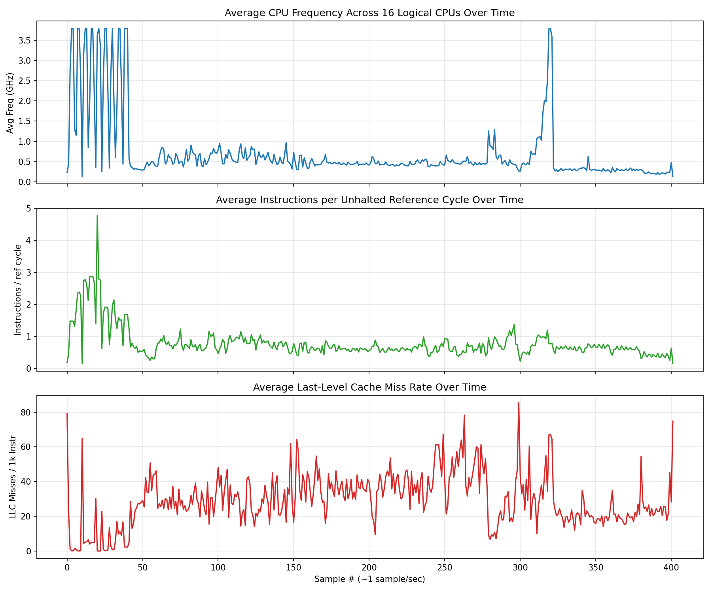</td>

</tr></table>

### Per-core frequency heatmap

<table><tr>

<td align="center"><b>20261103_213137 HighPerformance</b> 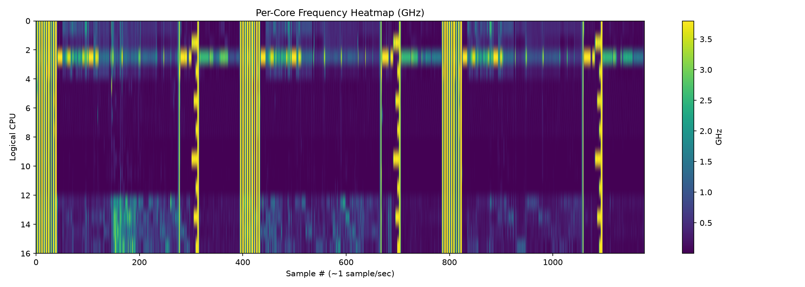</td>

<td align="center"><b>20261103_231839 UltimatePerformance</b> 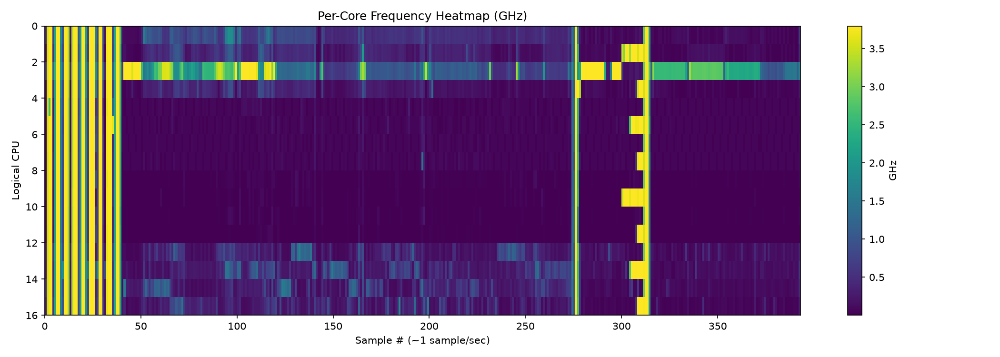</td>

<td align="center"><b>20261103_233441 PowerSaver</b> 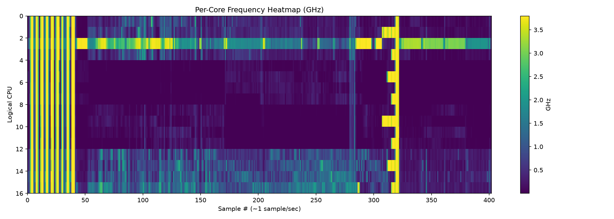</td>

</tr></table>

### C-state residency

<table><tr>

<td align="center"><b>20261103_213137 HighPerformance</b> 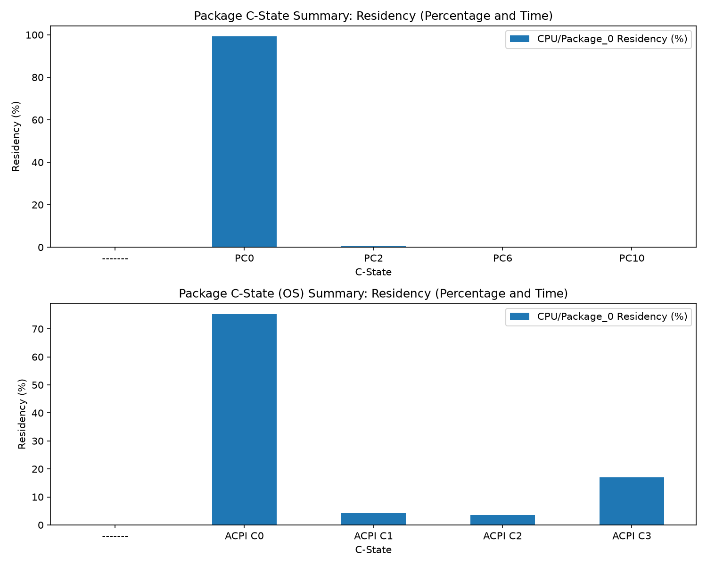</td>

<td align="center"><b>20261103_231839 UltimatePerformance</b> 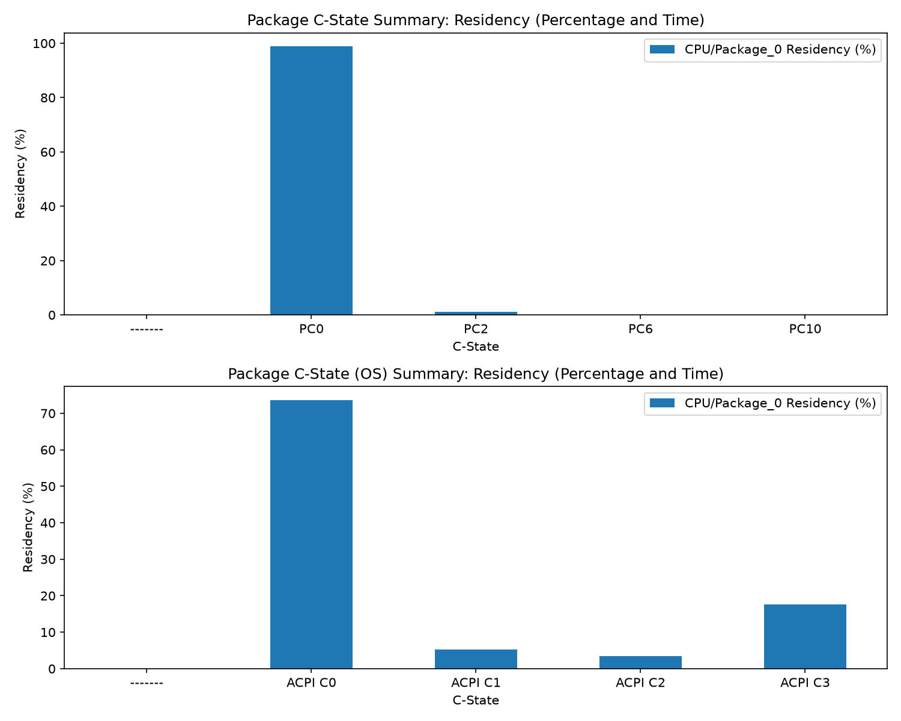</td>

<td align="center"><b>20261103_233441 PowerSaver</b> 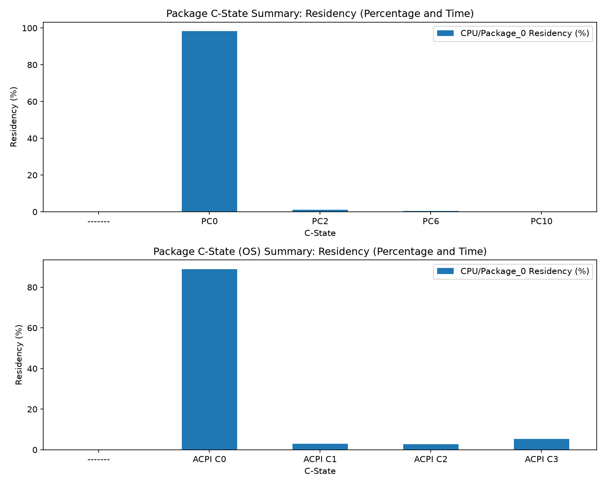</td>

</tr></table>

### PassMark sub-test percentiles

<table><tr>

<td align="center"><b>20261103_213137 HighPerformance</b> 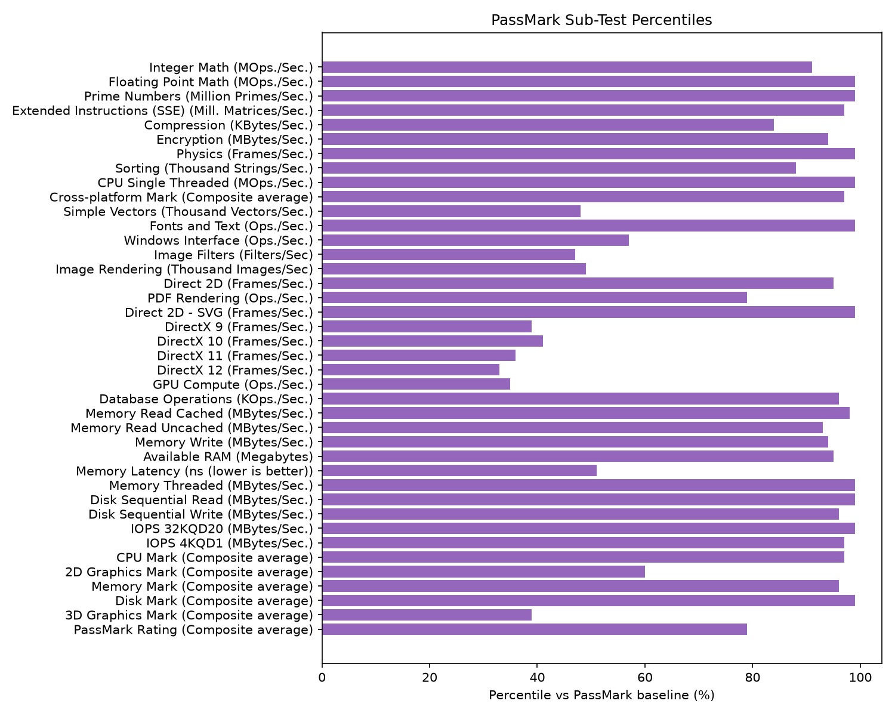</td>

<td align="center"><b>20261103_231839 UltimatePerformance</b> 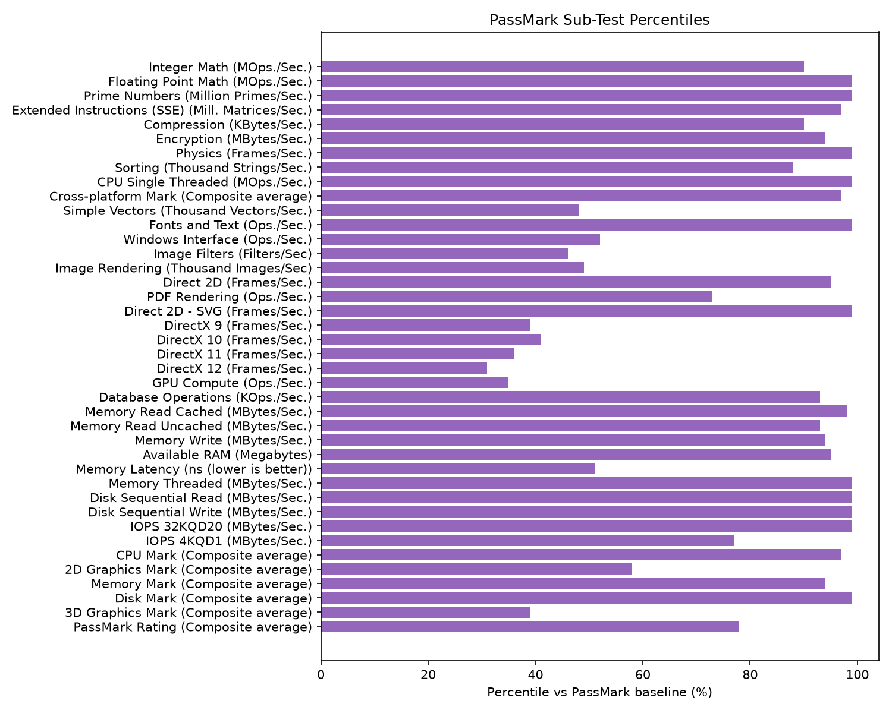</td>

<td align="center"><b>20261103_233441 PowerSaver</b> 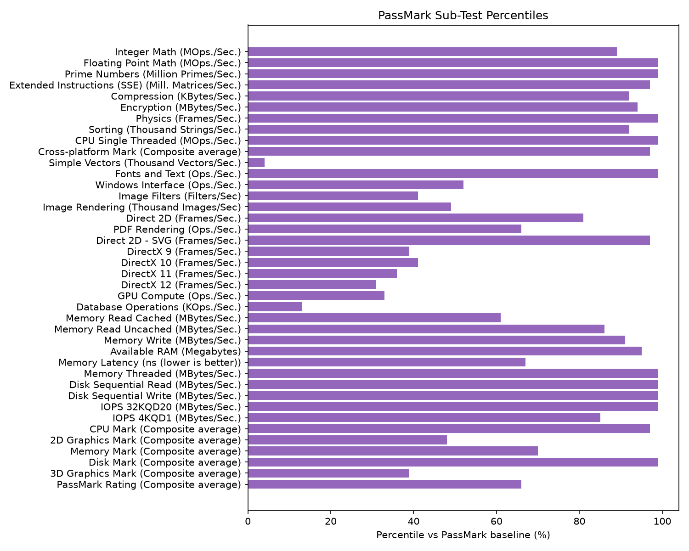</td>

</tr></table>

## Comparison by Power Plan

Grouped mean per power plan (n = number of runs in that group). With few runs per group this is **descriptive, not statistically significant** — treat as a starting point for which plan looks favorable per metric, then confirm with repeats.

| power_plan          |   n |   PassMark Rating (Composite average) |   CPU Mark (Composite average) |   Memory Mark (Composite average) |   Disk Mark (Composite average) |   2D Graphics Mark (Composite average) |   3D Graphics Mark (Composite average) |   avg_pkg_power_mW |   avg_active_freq_mhz |   pkg_c0_pct |   avg_ipc |   avg_cache_miss_per_kinst |   collection_duration_sec |
|:--------------------|----:|--------------------------------------:|-------------------------------:|----------------------------------:|--------------------------------:|---------------------------------------:|---------------------------------------:|-------------------:|----------------------:|-------------:|----------:|---------------------------:|--------------------------:|
| HighPerformance     |   1 |                                6427   |                        34163.7 |                            3721.9 |                         35885.3 |                                  713.6 |                                 4226.6 |            17945.2 |               3306.94 |        75.33 |      1.01 |                      20.47 |                   1186.1  |
| PowerSaver          |   1 |                                5121   |                        33906.2 |                            2966.3 |                         40235.7 |                                  524.9 |                                 4128.3 |            13823.8 |               2898.75 |        88.97 |      0.78 |                      29.5  |                    402.07 |
| UltimatePerformance |   1 |                                6315.2 |                        34355.6 |                            3663.6 |                         41849.9 |                                  693.3 |                                 4173.5 |            17562.9 |               3297.31 |        73.67 |      0.95 |                      24.73 |                    394.16 |

## Run-to-Run Repeatability (All Runs, Mixed Config)

Mean / standard deviation / coefficient of variation (CoV%) across **all** collected runs regardless of power plan — inflated by any power-plan differences above, so use the per-plan breakdown for a cleaner repeatability read once you have ≥2 runs per plan.

|                                      |      mean |      std |   cov_pct |
|:-------------------------------------|----------:|---------:|----------:|
| PassMark Rating (Composite average)  |  5954.4   |  723.907 |     12.16 |
| CPU Mark (Composite average)         | 34141.8   |  225.497 |      0.66 |
| Memory Mark (Composite average)      |  3450.6   |  420.428 |     12.18 |
| Disk Mark (Composite average)        | 39323.6   | 3085.13  |      7.85 |
| 2D Graphics Mark (Composite average) |   643.933 |  103.584 |     16.09 |
| 3D Graphics Mark (Composite average) |  4176.13  |   49.203 |      1.18 |
| avg_pkg_power_mW                     | 16444     | 2277.21  |     13.85 |
| avg_active_freq_mhz                  |  3167.67  |  232.938 |      7.35 |
| pkg_c0_pct                           |    79.323 |    8.395 |     10.58 |
| avg_ipc                              |     0.915 |    0.119 |     12.99 |
| avg_cache_miss_per_kinst             |    24.9   |    4.517 |     18.14 |
| collection_duration_sec              |   660.776 |  454.961 |     68.85 |

## Correlation Matrix

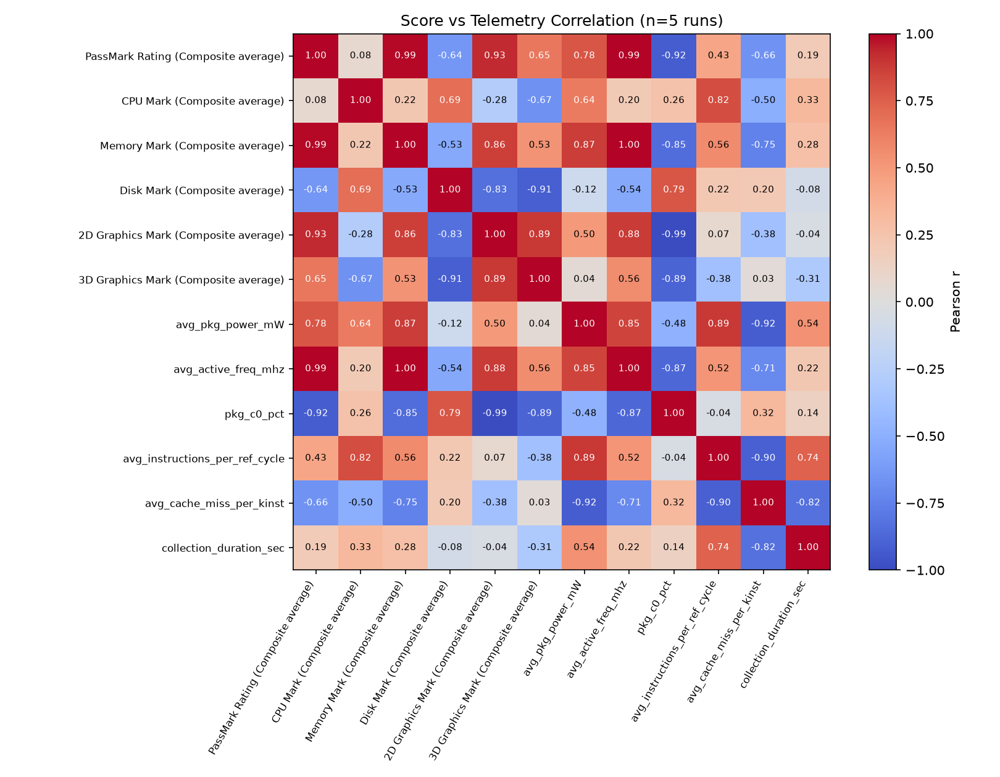

|                                      |   PassMark Rating (Composite average) |   CPU Mark (Composite average) |   Memory Mark (Composite average) |   Disk Mark (Composite average) |   2D Graphics Mark (Composite average) |   3D Graphics Mark (Composite average) |   avg_pkg_power_mW |   avg_active_freq_mhz |   pkg_c0_pct |   avg_ipc |   avg_cache_miss_per_kinst |   collection_duration_sec |
|:-------------------------------------|--------------------------------------:|-------------------------------:|----------------------------------:|--------------------------------:|---------------------------------------:|---------------------------------------:|-------------------:|----------------------:|-------------:|----------:|---------------------------:|--------------------------:|
| PassMark Rating (Composite average)  |                                  1    |                           0.87 |                              1    |                           -0.33 |                                   1    |                                   0.88 |               1    |                  1    |        -0.98 |      0.99 |                      -0.92 |                      0.56 |
| CPU Mark (Composite average)         |                                  0.87 |                           1    |                              0.87 |                            0.18 |                                   0.86 |                                   0.53 |               0.87 |                  0.9  |        -0.94 |      0.78 |                      -0.6  |                      0.08 |
| Memory Mark (Composite average)      |                                  1    |                           0.87 |                              1    |                           -0.32 |                                   1    |                                   0.88 |               1    |                  1    |        -0.99 |      0.99 |                      -0.91 |                      0.55 |
| Disk Mark (Composite average)        |                                 -0.33 |                           0.18 |                             -0.32 |                            1    |                                  -0.35 |                                  -0.74 |              -0.34 |                 -0.28 |         0.16 |     -0.48 |                       0.68 |                     -0.97 |
| 2D Graphics Mark (Composite average) |                                  1    |                           0.86 |                              1    |                           -0.35 |                                   1    |                                   0.89 |               1    |                  1    |        -0.98 |      0.99 |                      -0.92 |                      0.58 |
| 3D Graphics Mark (Composite average) |                                  0.88 |                           0.53 |                              0.88 |                           -0.74 |                                   0.89 |                                   1    |               0.88 |                  0.85 |        -0.78 |      0.95 |                      -1    |                      0.88 |
| avg_pkg_power_mW                     |                                  1    |                           0.87 |                              1    |                           -0.34 |                                   1    |                                   0.88 |               1    |                  1    |        -0.98 |      0.99 |                      -0.92 |                      0.56 |
| avg_active_freq_mhz                  |                                  1    |                           0.9  |                              1    |                           -0.28 |                                   1    |                                   0.85 |               1    |                  1    |        -0.99 |      0.98 |                      -0.89 |                      0.51 |
| pkg_c0_pct                           |                                 -0.98 |                          -0.94 |                             -0.99 |                            0.16 |                                  -0.98 |                                  -0.78 |              -0.98 |                 -0.99 |         1    |     -0.94 |                       0.83 |                     -0.4  |
| avg_ipc                              |                                  0.99 |                           0.78 |                              0.99 |                           -0.48 |                                   0.99 |                                   0.95 |               0.99 |                  0.98 |        -0.94 |      1    |                      -0.97 |                      0.69 |
| avg_cache_miss_per_kinst             |                                 -0.92 |                          -0.6  |                             -0.91 |                            0.68 |                                  -0.92 |                                  -1    |              -0.92 |                 -0.89 |         0.83 |     -0.97 |                       1    |                     -0.84 |
| collection_duration_sec              |                                  0.56 |                           0.08 |                              0.55 |                           -0.97 |                                   0.58 |                                   0.88 |               0.56 |                  0.51 |        -0.4  |      0.69 |                      -0.84 |                      1    |

## Strongest Score ↔ Telemetry Relationships

| Score | Telemetry | r | p-value | n |
|---|---|---|---|---|

| PassMark Rating (Composite average) | avg_pkg_power_mW | 1.00 | 0.004 | 3 |

| 2D Graphics Mark (Composite average) | avg_pkg_power_mW | 1.00 | 0.009 | 3 |

| Memory Mark (Composite average) | avg_pkg_power_mW | 1.00 | 0.009 | 3 |

| Memory Mark (Composite average) | avg_active_freq_mhz | 1.00 | 0.031 | 3 |

| PassMark Rating (Composite average) | avg_active_freq_mhz | 1.00 | 0.036 | 3 |

| 2D Graphics Mark (Composite average) | avg_active_freq_mhz | 1.00 | 0.049 | 3 |

| 3D Graphics Mark (Composite average) | avg_cache_miss_per_kinst | -1.00 | 0.051 | 3 |

| 2D Graphics Mark (Composite average) | avg_ipc | 0.99 | 0.091 | 3 |

| PassMark Rating (Composite average) | avg_ipc | 0.99 | 0.104 | 3 |

| Memory Mark (Composite average) | pkg_c0_pct | -0.99 | 0.107 | 3 |

## Scatter Plots (Top 6 by |r|)

### PassMark Rating (Composite average) vs avg_pkg_power_mW (r=1.00, p=0.004, n=3)

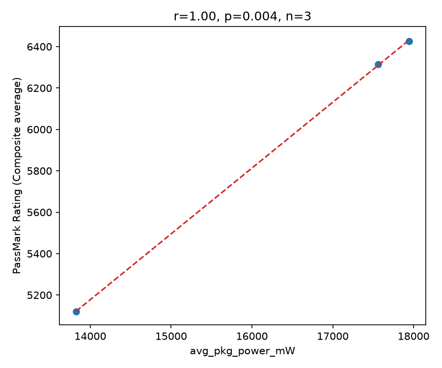

### 2D Graphics Mark (Composite average) vs avg_pkg_power_mW (r=1.00, p=0.009, n=3)

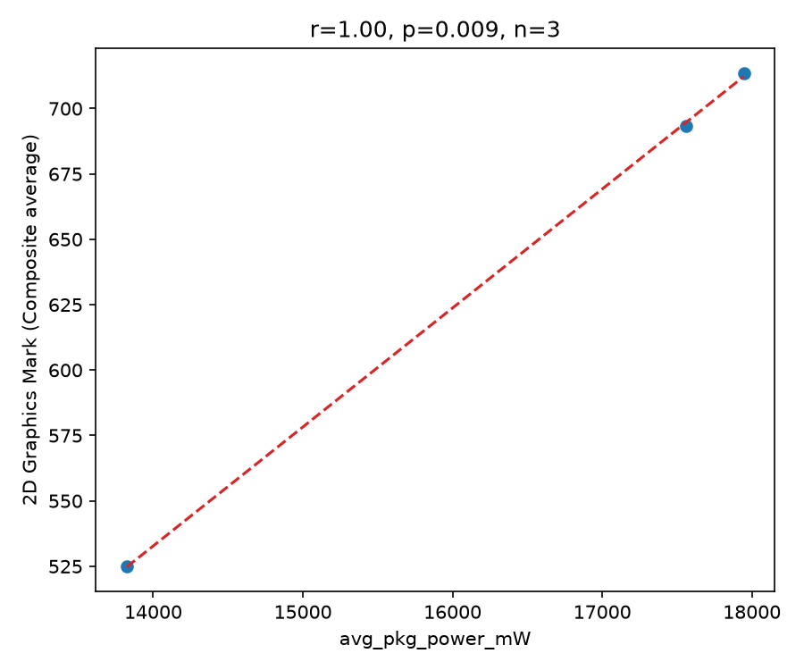

### Memory Mark (Composite average) vs avg_pkg_power_mW (r=1.00, p=0.009, n=3)

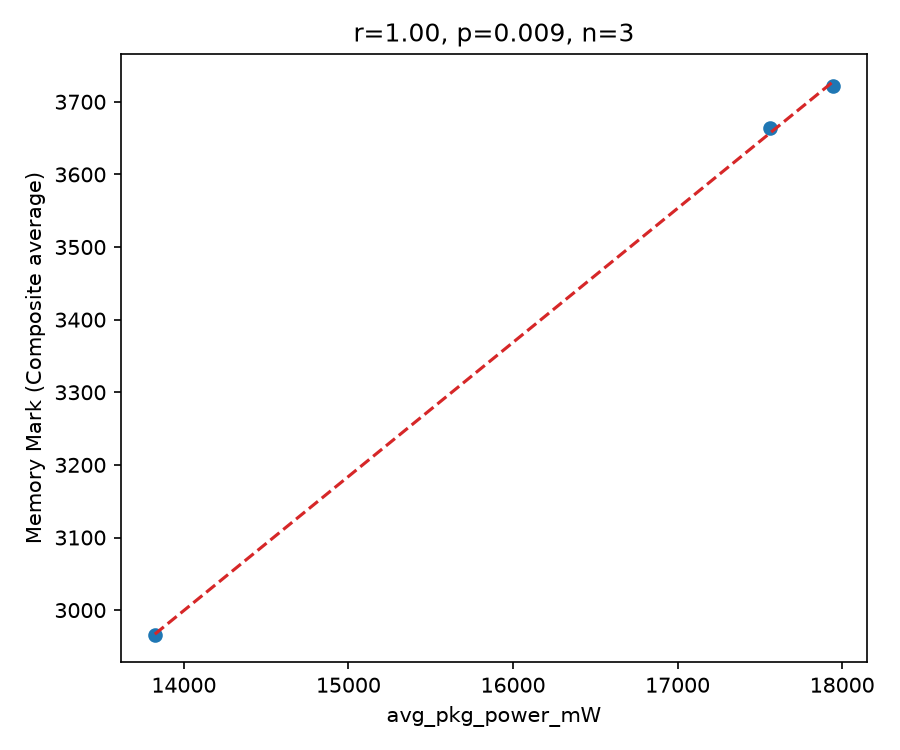

### Memory Mark (Composite average) vs avg_active_freq_mhz (r=1.00, p=0.031, n=3)

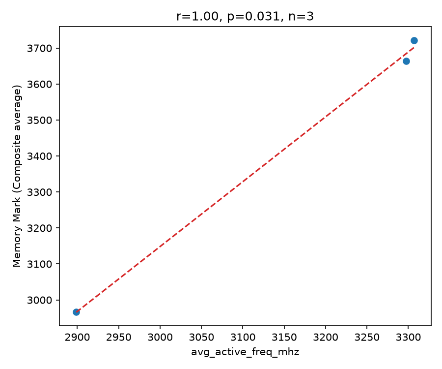

### PassMark Rating (Composite average) vs avg_active_freq_mhz (r=1.00, p=0.036, n=3)

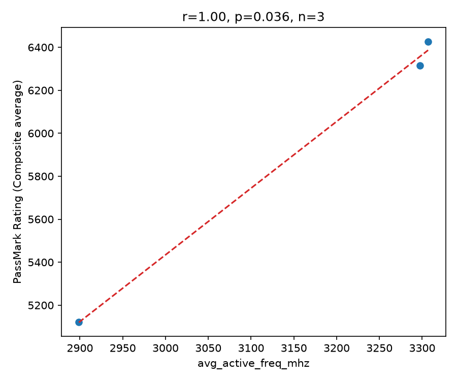

### 2D Graphics Mark (Composite average) vs avg_active_freq_mhz (r=1.00, p=0.049, n=3)

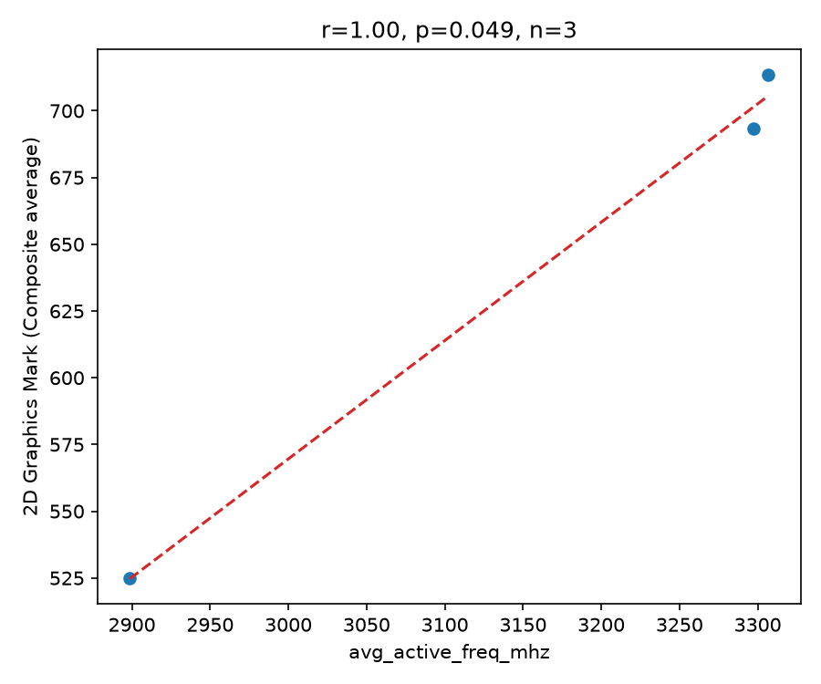

## How to Read This for SKU/Workload Behavior

- A **positive r between a score and average package power/frequency** suggests the workload scales with power/turbo headroom — i.e. the SKU is power- or frequency-limited for that sub-test, and raising power limits (PL1/PL2) or cooling should move the score.
- A **flat/near-zero r** suggests the sub-test is bound by something else telemetry here doesn't capture well (e.g., GPU-bound DirectX tests vs. CPU-only telemetry, disk I/O, memory latency) — look at `2D/3D Graphics Mark` vs CPU telemetry as the expected example of weak correlation.
- A **negative r with C0 residency** can indicate the benchmark finishes faster (less busy time / score) at higher scores, or that runs with more idle/background interference score lower — inspect the specific run rows, don't over-interpret from r alone.
- To get statistically solid conclusions: run more repeats per configuration, vary one knob at a time (e.g., PL1/PL2, frequency cap), and keep workload identical across runs.
