# Telemetry ↔ PassMark Score Correlation Report

Generated from `C:\Users\Local_Admin\passmark-socwatch-emon-win\reports\telemetry_correlation_report\CoreUltra7_366H` — 5 runs with usable data (PassMark + SoCWatch, EMON).

## Test-Bed Configuration

- **CPU**: Intel(R) Core(TM) Ultra 7 366H

- **Cores/Threads**: 16 cores / 16 threads

- **Memory**: 64 GB across 2 module(s)

- **BIOS**: PTLPFWI1.R00.3515.D56.2601280733

- **GPU**: Intel(R) Graphics - driver 32.0.101.8357 (12/01/2025 16:00:00)

- **Power plan**: varies per run (3 plans tested: HighPerformance, PowerSaver, UltimatePerformance) — see breakdown below.

## Tool Versions per Run

| Run | Power plan | PassMark | SoC Watch | EMON |
|---|---|---|---|---|

| 20261103_213137 | HighPerformance | 10.2 | 2026.2.0 | V11.61 |

| 20261103_231839 | UltimatePerformance | 10.2 | 2026.2.0 | V11.61 |

| 20261103_233441 | PowerSaver | 10.2 | 2026.2.0 | V11.61 |

| 20261110_191135 | UltimatePerformance | 11.1 | 2026.6.0 | V11.61 |

| 20261110_192426 | HighPerformance | 11.1 | 2026.6.0 | V11.61 |

Runs on different PassMark major versions are **not strictly comparable** (sub-test workloads and baselines differ); compare within a version first.

## Methodology

- **PassMark** supplies one composite/sub-test score per run (`PassMark_PerfRes.txt`), not a time series.
- **SoCWatch** (`socwatch.csv`) supplies whole-run summary telemetry: average package power (mW), average active CPU frequency excluding idle time (MHz), and package C-state residency (% time in ACPI C0 = active).
- **EMON** (`emon.csv`), where present, supplies ~1-sample/sec counters across the full run; instructions per unhalted reference cycle are INST_RETIRED.ANY / CPU_CLK_UNHALTED.REF_TSC, averaged equally over valid core/sample rows. This is not conventional IPC (instructions per actual core cycle); the historical captures lack an actual-cycle counter. LLC miss rates are also averaged.
- Each **run becomes one observation**; correlation (Pearson r) is computed **across runs** between score metrics and telemetry metrics — this is the only valid level for score correlation since PassMark itself has no internal time resolution.
- ⚠️ **Caveat**: with **n=5** runs on a single SKU/system (1-2 runs per power plan), these are exploratory correlations, not statistically robust conclusions:
  - Each PassMark score is itself already an average across the run's internal **1-3 iterations** (3 for the PassMark 10.2 runs, 1 for the PassMark 11.1 runs), so the *score* values have reasonably low pure benchmark-noise.
  - However, **telemetry (SoCWatch/EMON) was captured once per run**, not separately per iteration — so we don't know iteration-to-iteration telemetry variance (e.g., thermal ramp across the iterations), and runs were executed back-to-back without controlling for thermal/background-state carryover between power-plan switches.
  - With only a handful of distinct conditions, a single atypical plan can dominate the fit — p<0.05 here should be read as a credible **directional** signal worth acting on, not a finalized regression. Confirming with 1-2 repeat runs per plan (especially for any plan that looks like an outlier) would turn this from directional into robust.

## Per-Run Summary Table

|             run | power_plan          |   PassMark Rating (Composite average) |   CPU Mark (Composite average) |   Memory Mark (Composite average) |   Disk Mark (Composite average) |   2D Graphics Mark (Composite average) |   3D Graphics Mark (Composite average) |   avg_pkg_power_mW |   avg_active_freq_mhz |   pkg_c0_pct |   avg_instructions_per_ref_cycle |   avg_cache_miss_per_kinst |   collection_duration_sec |
|----------------:|:--------------------|--------------------------------------:|-------------------------------:|----------------------------------:|--------------------------------:|---------------------------------------:|---------------------------------------:|-------------------:|----------------------:|-------------:|---------------------------------:|---------------------------:|--------------------------:|
| 20261103_213137 | HighPerformance     |                                6427   |                        34163.7 |                            3721.9 |                         35885.3 |                                  713.6 |                                 4226.6 |            17945.2 |               3306.94 |        75.33 |                             1.01 |                      20.47 |                   1186.1  |
| 20261103_231839 | UltimatePerformance |                                6315.2 |                        34355.6 |                            3663.6 |                         41849.9 |                                  693.3 |                                 4173.5 |            17562.9 |               3297.31 |        73.67 |                             0.95 |                      24.73 |                    394.16 |
| 20261103_233441 | PowerSaver          |                                5121   |                        33906.2 |                            2966.3 |                         40235.7 |                                  524.9 |                                 4128.3 |            13823.8 |               2898.75 |        88.97 |                             0.78 |                      29.5  |                    402.07 |
| 20261110_191135 | UltimatePerformance |                                6638.5 |                        33864.4 |                            3724.6 |                         32162.1 |                                  849.4 |                                 4804.5 |            16242.1 |               3336.94 |        61.68 |                             0.85 |                      25.89 |                    411.49 |
| 20261110_192426 | HighPerformance     |                                6613.9 |                        33822.5 |                            3727   |                         31593.2 |                                  857.1 |                                 4787.4 |            16361.5 |               3335.12 |        62.06 |                             0.82 |                      25.47 |                    411.29 |

## Per-Run Detailed Plots (Side-by-Side by Plot Type)

Each completed run also has its own 4-plot deep-dive (generated by `analyze_run.py` / `analyze_all.py`), covering within-run telemetry trends that the cross-run tables above don't show. Grouped here by plot type so runs/power plans can be compared side by side; click/open an image for full resolution.

### Timeseries overview (freq / instructions per ref cycle / cache-miss)

<table><tr>

<td align="center"><b>20261103_213137 HighPerformance</b> </td>

<td align="center"><b>20261103_231839 UltimatePerformance</b> </td>

<td align="center"><b>20261103_233441 PowerSaver</b> </td>

<td align="center"><b>20261110_191135 UltimatePerformance</b> 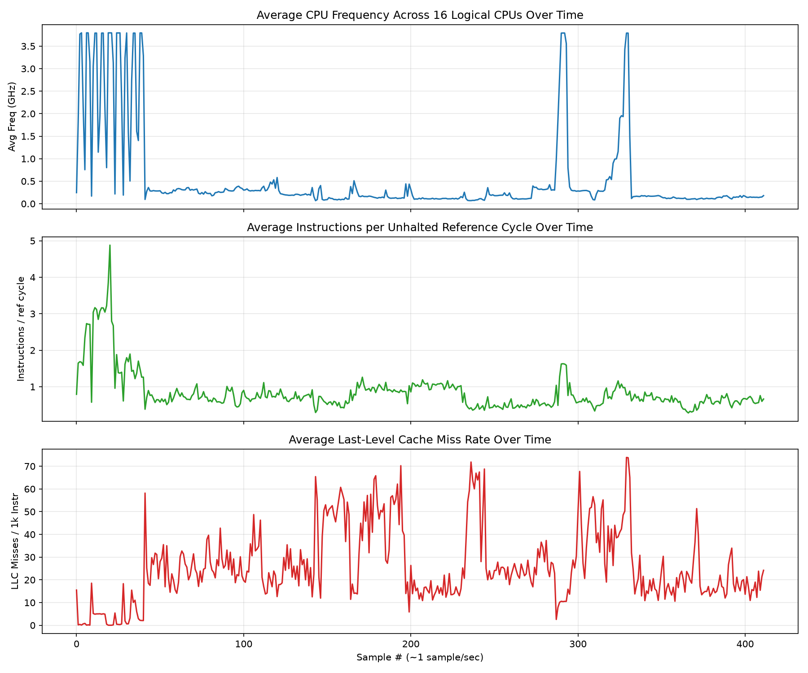</td>

<td align="center"><b>20261110_192426 HighPerformance</b> 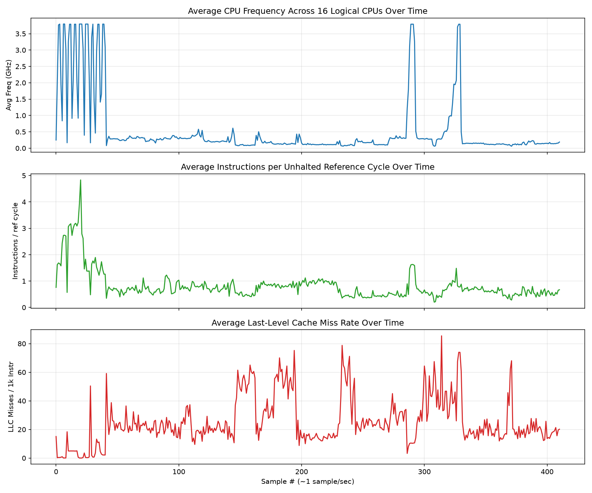</td>

</tr></table>

### Per-core frequency heatmap

<table><tr>

<td align="center"><b>20261103_213137 HighPerformance</b> </td>

<td align="center"><b>20261103_231839 UltimatePerformance</b> </td>

<td align="center"><b>20261103_233441 PowerSaver</b> </td>

<td align="center"><b>20261110_191135 UltimatePerformance</b> 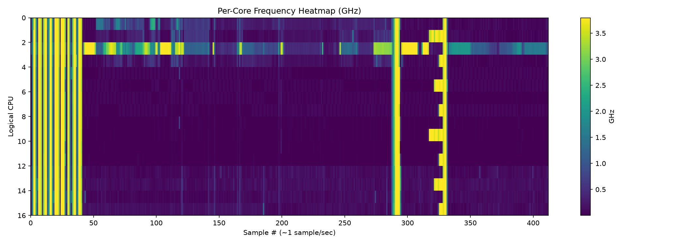</td>

<td align="center"><b>20261110_192426 HighPerformance</b> 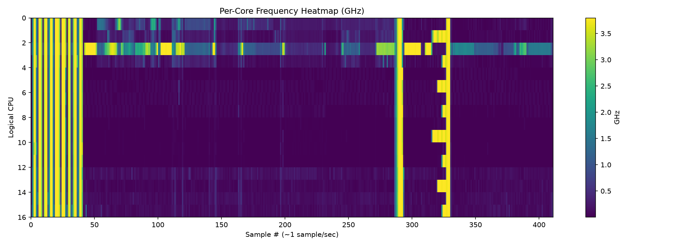</td>

</tr></table>

### C-state residency

<table><tr>

<td align="center"><b>20261103_213137 HighPerformance</b> </td>

<td align="center"><b>20261103_231839 UltimatePerformance</b> </td>

<td align="center"><b>20261103_233441 PowerSaver</b> </td>

<td align="center"><b>20261110_191135 UltimatePerformance</b> 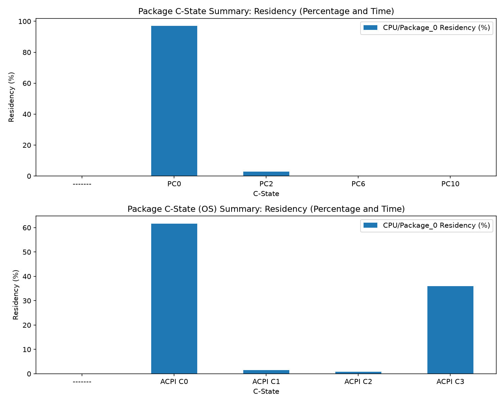</td>

<td align="center"><b>20261110_192426 HighPerformance</b> 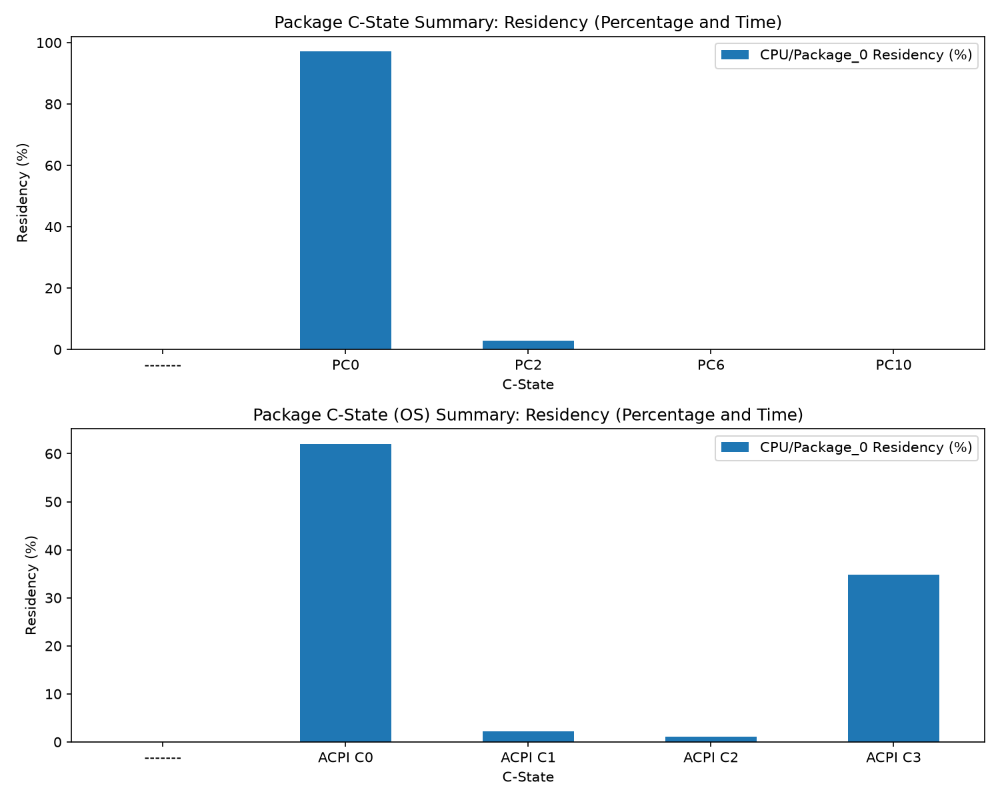</td>

</tr></table>

### PassMark sub-test percentiles

<table><tr>

<td align="center"><b>20261103_213137 HighPerformance</b> </td>

<td align="center"><b>20261103_231839 UltimatePerformance</b> </td>

<td align="center"><b>20261103_233441 PowerSaver</b> </td>

<td align="center"><b>20261110_191135 UltimatePerformance</b> 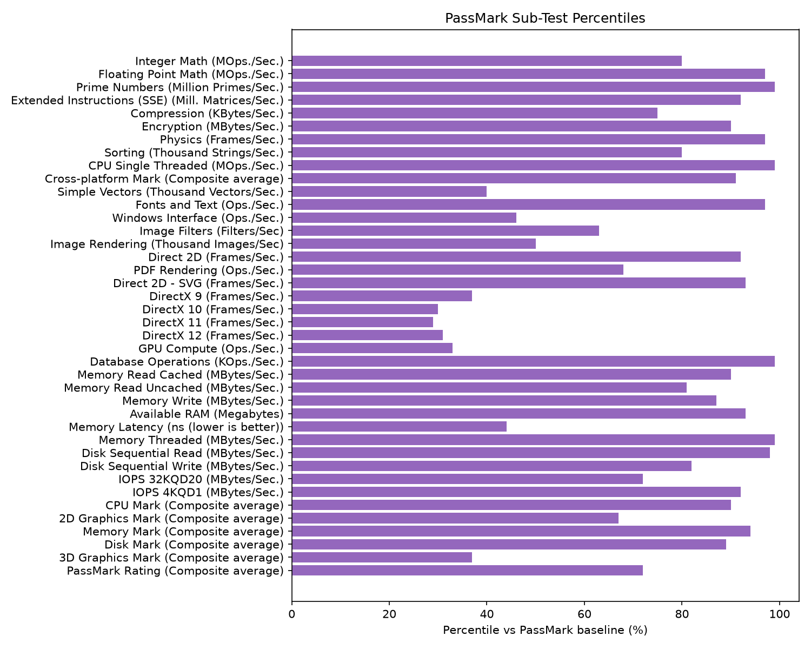</td>

<td align="center"><b>20261110_192426 HighPerformance</b> 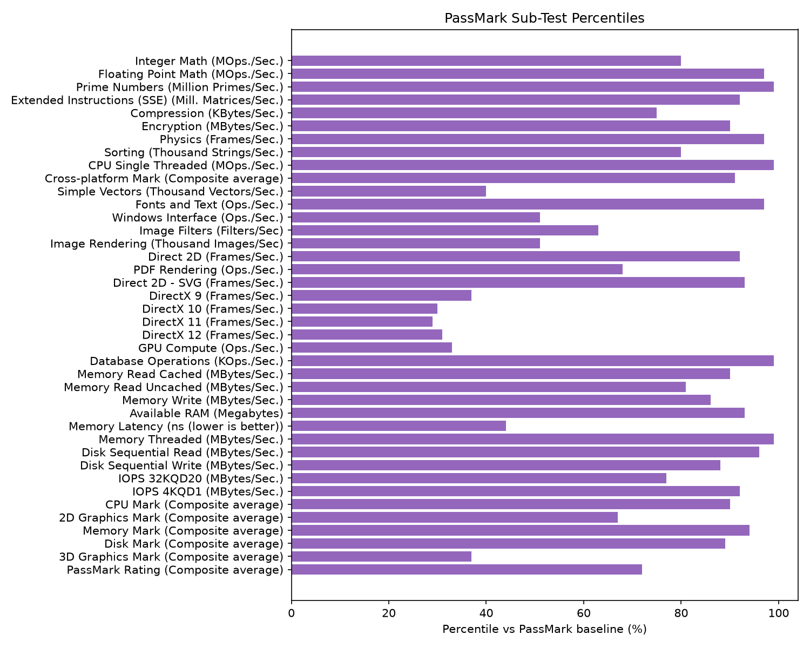</td>

</tr></table>

## Comparison by Power Plan

Grouped mean per power plan (n = number of runs in that group). With few runs per group this is **descriptive, not statistically significant** — treat as a starting point for which plan looks favorable per metric, then confirm with repeats.

| power_plan          |   n |   PassMark Rating (Composite average) |   CPU Mark (Composite average) |   Memory Mark (Composite average) |   Disk Mark (Composite average) |   2D Graphics Mark (Composite average) |   3D Graphics Mark (Composite average) |   avg_pkg_power_mW |   avg_active_freq_mhz |   pkg_c0_pct |   avg_instructions_per_ref_cycle |   avg_cache_miss_per_kinst |   collection_duration_sec |
|:--------------------|----:|--------------------------------------:|-------------------------------:|----------------------------------:|--------------------------------:|---------------------------------------:|---------------------------------------:|-------------------:|----------------------:|-------------:|---------------------------------:|---------------------------:|--------------------------:|
| HighPerformance     |   2 |                               6520.45 |                        33993.1 |                           3724.45 |                         33739.2 |                                 785.35 |                                 4507   |            17153.4 |               3321.03 |        68.69 |                             0.92 |                      22.97 |                    798.7  |
| PowerSaver          |   1 |                               5121    |                        33906.2 |                           2966.3  |                         40235.7 |                                 524.9  |                                 4128.3 |            13823.8 |               2898.75 |        88.97 |                             0.78 |                      29.5  |                    402.07 |
| UltimatePerformance |   2 |                               6476.85 |                        34110   |                           3694.1  |                         37006   |                                 771.35 |                                 4489   |            16902.5 |               3317.12 |        67.68 |                             0.9  |                      25.31 |                    402.82 |

## Run-to-Run Repeatability (All Runs, Mixed Config)

Mean / standard deviation / coefficient of variation (CoV%) across **all** collected runs regardless of power plan — inflated by any power-plan differences above, so use the per-plan breakdown for a cleaner repeatability read once you have ≥2 runs per plan.

|                                      |      mean |      std |   cov_pct |
|:-------------------------------------|----------:|---------:|----------:|
| PassMark Rating (Composite average)  |  6223.12  |  630.469 |     10.13 |
| CPU Mark (Composite average)         | 34022.5   |  228.809 |      0.67 |
| Memory Mark (Composite average)      |  3560.68  |  333.318 |      9.36 |
| Disk Mark (Composite average)        | 36345.2   | 4629.5   |     12.74 |
| 2D Graphics Mark (Composite average) |   727.66  |  136.075 |     18.7  |
| 3D Graphics Mark (Composite average) |  4424.06  |  341.319 |      7.72 |
| avg_pkg_power_mW                     | 16387.1   | 1612.66  |      9.84 |
| avg_active_freq_mhz                  |  3235.01  |  188.771 |      5.84 |
| pkg_c0_pct                           |    72.342 |   11.254 |     15.56 |
| avg_instructions_per_ref_cycle       |     0.883 |    0.096 |     10.82 |
| avg_cache_miss_per_kinst             |    25.212 |    3.226 |     12.79 |
| collection_duration_sec              |   561.022 |  349.504 |     62.3  |

## Correlation Matrix

|                                      |   PassMark Rating (Composite average) |   CPU Mark (Composite average) |   Memory Mark (Composite average) |   Disk Mark (Composite average) |   2D Graphics Mark (Composite average) |   3D Graphics Mark (Composite average) |   avg_pkg_power_mW |   avg_active_freq_mhz |   pkg_c0_pct |   avg_instructions_per_ref_cycle |   avg_cache_miss_per_kinst |   collection_duration_sec |
|:-------------------------------------|--------------------------------------:|-------------------------------:|----------------------------------:|--------------------------------:|---------------------------------------:|---------------------------------------:|-------------------:|----------------------:|-------------:|---------------------------------:|---------------------------:|--------------------------:|
| PassMark Rating (Composite average)  |                                  1    |                           0.08 |                              0.99 |                           -0.64 |                                   0.93 |                                   0.65 |               0.78 |                  0.99 |        -0.92 |                             0.43 |                      -0.66 |                      0.19 |
| CPU Mark (Composite average)         |                                  0.08 |                           1    |                              0.22 |                            0.69 |                                  -0.28 |                                  -0.67 |               0.64 |                  0.2  |         0.26 |                             0.82 |                      -0.5  |                      0.33 |
| Memory Mark (Composite average)      |                                  0.99 |                           0.22 |                              1    |                           -0.53 |                                   0.86 |                                   0.53 |               0.87 |                  1    |        -0.85 |                             0.56 |                      -0.75 |                      0.28 |
| Disk Mark (Composite average)        |                                 -0.64 |                           0.69 |                             -0.53 |                            1    |                                  -0.83 |                                  -0.91 |              -0.12 |                 -0.54 |         0.79 |                             0.22 |                       0.2  |                     -0.08 |
| 2D Graphics Mark (Composite average) |                                  0.93 |                          -0.28 |                              0.86 |                           -0.83 |                                   1    |                                   0.89 |               0.5  |                  0.88 |        -0.99 |                             0.07 |                      -0.38 |                     -0.04 |
| 3D Graphics Mark (Composite average) |                                  0.65 |                          -0.67 |                              0.53 |                           -0.91 |                                   0.89 |                                   1    |               0.04 |                  0.56 |        -0.89 |                            -0.38 |                       0.03 |                     -0.31 |
| avg_pkg_power_mW                     |                                  0.78 |                           0.64 |                              0.87 |                           -0.12 |                                   0.5  |                                   0.04 |               1    |                  0.85 |        -0.48 |                             0.89 |                      -0.92 |                      0.54 |
| avg_active_freq_mhz                  |                                  0.99 |                           0.2  |                              1    |                           -0.54 |                                   0.88 |                                   0.56 |               0.85 |                  1    |        -0.87 |                             0.52 |                      -0.71 |                      0.22 |
| pkg_c0_pct                           |                                 -0.92 |                           0.26 |                             -0.85 |                            0.79 |                                  -0.99 |                                  -0.89 |              -0.48 |                 -0.87 |         1    |                            -0.04 |                       0.32 |                      0.14 |
| avg_instructions_per_ref_cycle       |                                  0.43 |                           0.82 |                              0.56 |                            0.22 |                                   0.07 |                                  -0.38 |               0.89 |                  0.52 |        -0.04 |                             1    |                      -0.9  |                      0.74 |
| avg_cache_miss_per_kinst             |                                 -0.66 |                          -0.5  |                             -0.75 |                            0.2  |                                  -0.38 |                                   0.03 |              -0.92 |                 -0.71 |         0.32 |                            -0.9  |                       1    |                     -0.82 |
| collection_duration_sec              |                                  0.19 |                           0.33 |                              0.28 |                           -0.08 |                                  -0.04 |                                  -0.31 |               0.54 |                  0.22 |         0.14 |                             0.74 |                      -0.82 |                      1    |

## Strongest Score ↔ Telemetry Relationships

| Score | Telemetry | r | p-value | n |
|---|---|---|---|---|

| Memory Mark (Composite average) | avg_active_freq_mhz | 1.00 | 0.000 | 5 |

| 2D Graphics Mark (Composite average) | pkg_c0_pct | -0.99 | 0.001 | 5 |

| PassMark Rating (Composite average) | avg_active_freq_mhz | 0.99 | 0.001 | 5 |

| PassMark Rating (Composite average) | pkg_c0_pct | -0.92 | 0.028 | 5 |

| 3D Graphics Mark (Composite average) | pkg_c0_pct | -0.89 | 0.045 | 5 |

| 2D Graphics Mark (Composite average) | avg_active_freq_mhz | 0.88 | 0.049 | 5 |

| Memory Mark (Composite average) | avg_pkg_power_mW | 0.87 | 0.056 | 5 |

| Memory Mark (Composite average) | pkg_c0_pct | -0.85 | 0.070 | 5 |

| CPU Mark (Composite average) | avg_instructions_per_ref_cycle | 0.82 | 0.093 | 5 |

| Disk Mark (Composite average) | pkg_c0_pct | 0.79 | 0.114 | 5 |

## Scatter Plots (Top 6 by |r|)

### Memory Mark (Composite average) vs avg_active_freq_mhz (r=1.00, p=0.000, n=5)

### 2D Graphics Mark (Composite average) vs pkg_c0_pct (r=-0.99, p=0.001, n=5)

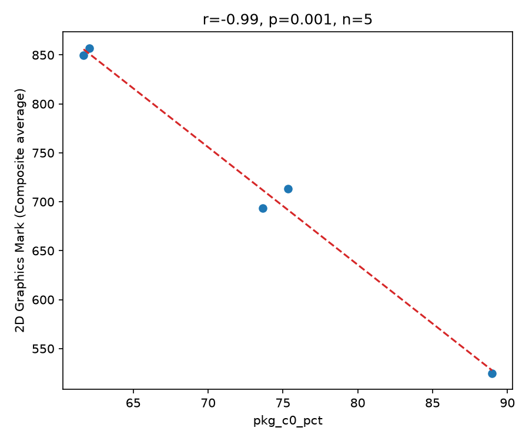

### PassMark Rating (Composite average) vs avg_active_freq_mhz (r=0.99, p=0.001, n=5)

### PassMark Rating (Composite average) vs pkg_c0_pct (r=-0.92, p=0.028, n=5)

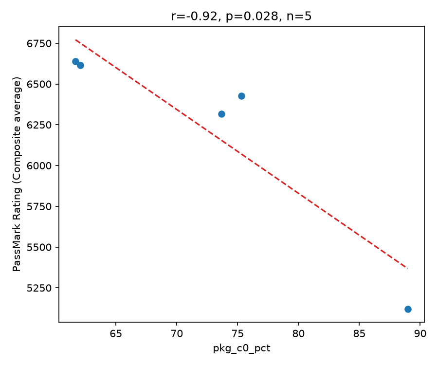

### 3D Graphics Mark (Composite average) vs pkg_c0_pct (r=-0.89, p=0.045, n=5)

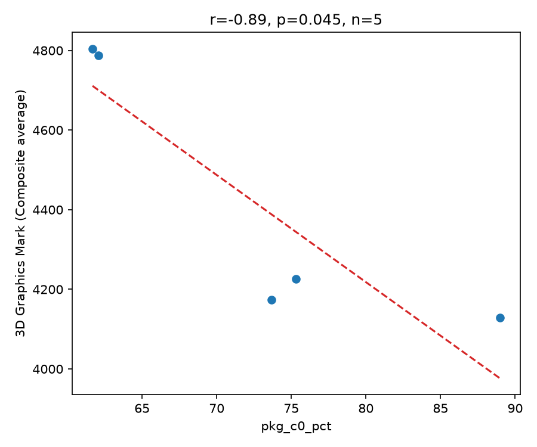

### 2D Graphics Mark (Composite average) vs avg_active_freq_mhz (r=0.88, p=0.049, n=5)

## How to Read This for SKU/Workload Behavior

- A **positive r between a score and average package power/frequency** suggests the workload scales with power/turbo headroom — i.e. the SKU is power- or frequency-limited for that sub-test, and raising power limits (PL1/PL2) or cooling should move the score.
- A **flat/near-zero r** suggests the sub-test is bound by something else telemetry here doesn't capture well (e.g., GPU-bound DirectX tests vs. CPU-only telemetry, disk I/O, memory latency) — look at `2D/3D Graphics Mark` vs CPU telemetry as the expected example of weak correlation.
- A **negative r with C0 residency** can indicate the benchmark finishes faster (less busy time / score) at higher scores, or that runs with more idle/background interference score lower — inspect the specific run rows, don't over-interpret from r alone.
- To get statistically solid conclusions: run more repeats per configuration, vary one knob at a time (e.g., PL1/PL2, frequency cap), and keep workload identical across runs.
